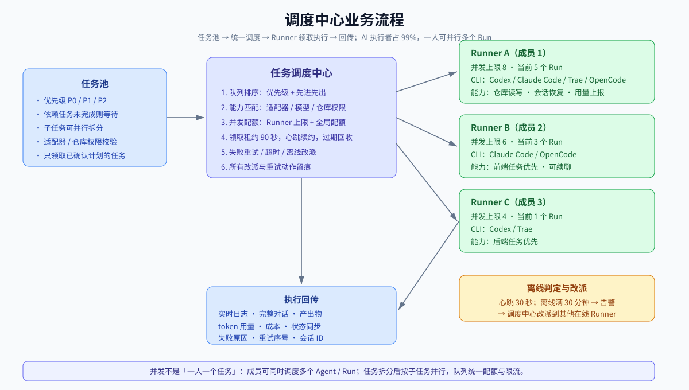
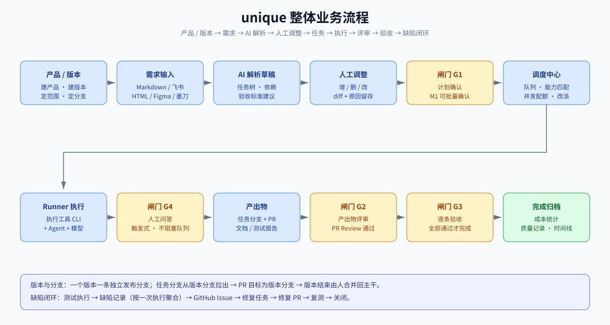
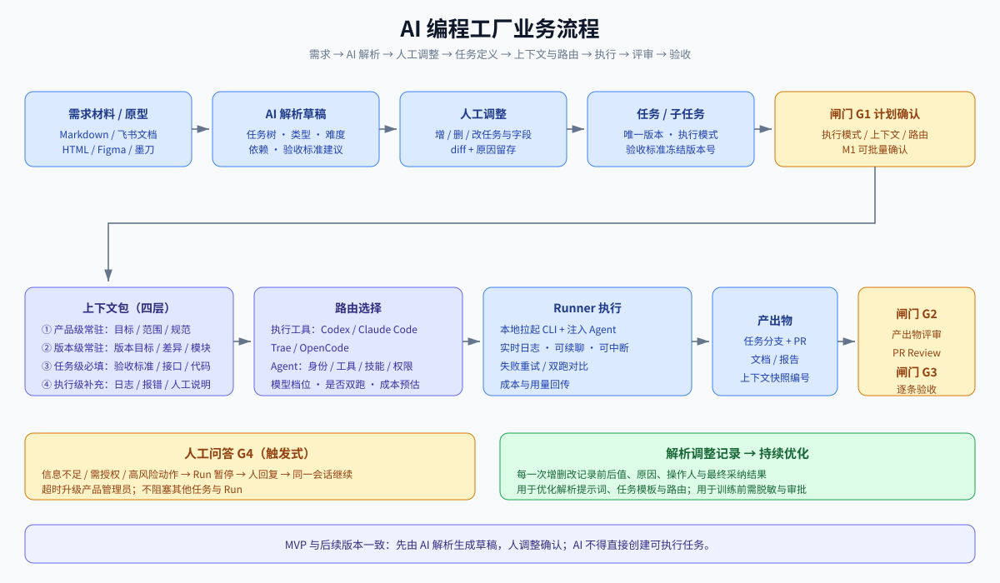
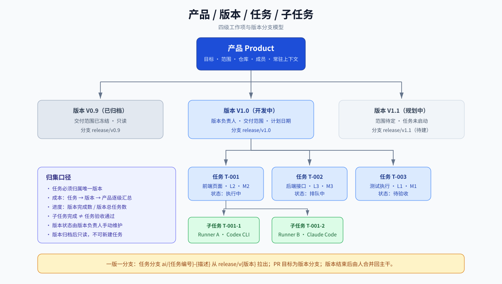
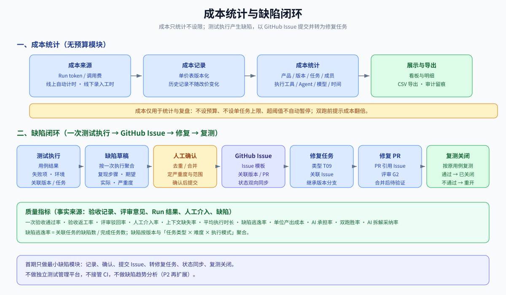

# unique 业务规格说明书

| 条目 | 内容 |
|---|---|
| 平台名称 | unique（暂定名） |
| 文档版本 | v0.6（评审草案） |
| 编写日期 | 2026-11-06 |
| 文档类型 | 业务规格说明书（Business Requirement Specification） |
| 适用范围 | 团队内部自用，单租户，不对外售卖 |
| 读者 | 产品经理、开发、测试、数据标注、产品负责人 |
| 文档边界 | 只定义业务行为、规则与数据口径，不定义技术架构、接口与数据库设计 |

**修订记录**

| 文档版本 | 日期 | 修改人 | 说明 |
|---|---|---|---|
| v0.1 | 2026-11-06 | AI 产品经理 | 首版，基于 24 项澄清归纳为 28 项决策 |
| v0.2 | 2026-11-06 | AI 产品经理 | 补充 7 项已确认参数：名称、人时单价、币种、模型单价来源、并发策略、日志留存与 Trae 接入 |
| v0.3 | 2026-11-06 | AI 产品经理 | 工作项改为四级「产品 → 版本 → 任务 → 子任务」；需求拆解统一改为「AI 先解析、人调整」，并留存调整记录 |
| v0.4 | 2026-11-06 | AI 产品经理 | 关闭 Q05–Q20；确认 10 人规模与 AI 高并发、GitHub 统一登录、四款首发 CLI、无预算模块、内建缺陷闭环、一版一分支；修正 Agent 与执行工具的定义；补充整体与模块业务流程图 |
| v0.5 | 2026-11-06 | AI 产品经理 | 撤销验收去掉时间限制；确认不使用飞书项目；备份改为月全量 + 12 小时增量、RTO 2 小时；归档恢复改为串行任务；补充 Codex 客户端与 Trae IDE 的接入调研结论；流程图移入对应章节 |
| v0.6 | 2026-11-11 | AI 产品经理 | 补齐账号、成员、产品成员关系与权限点对象；角色模板补齐到 5 个并给出管理角色默认权限；明确改派前置校验与执行人判定口径；补充 Agent 能力矩阵与降级规则；细化安全责任、脱敏、离职与设备丢失、部署、运行指标与备份归档口径；补齐成本记录字段、续聊成本归属、Run 结束时间、人工工时口径与补价回溯规则；新增测试执行、测试用例、用例结果三个对象，明确缺陷聚合去重键与 GitHub Issue 同步主从；补齐缺陷重开与同步映射；重写缺陷逃逸率与 AI 承担率口径；第 12 章改为可判定验收用例并补异常、越权、并发用例 |

---

## 一页速读

**一句话定义**：unique 是一个面向「AI 产品经理 + 开发小组」的内部协作平台，把 Codex CLI、Claude Code CLI、Trae CLI、OpenCode 等 AI 执行工具统一接入调度，用「需求 → 解析草稿 → 人工调整 → 任务 → 上下文包 → Agent 执行 → 产出评审 → 验收」的流水线把需求变成可合并的代码，并按产品统一呈现进度、质量、成本与分工。

**运行形态**：中央 Web 服务负责产品、版本、任务调度、看板、成本、缺陷、通知与集成；每名成员的电脑上安装本地 Runner，浏览器发起的指派任务由调度中心匹配 Runner 自动领取、在本地拉起 CLI 执行，执行日志、对话与产出物自动上传，形成团队共性视图；手机端通过响应式网页只读查看，统一使用 GitHub 账号登录。

**四条必须由人介入的闸门**：执行前计划确认、产出物（PR）评审、完成前验收、AI 卡住时的人工问答。

**MVP 主线**：调度优先——先把「多 CLI 统一调度 + 本地 Runner + 会话留存 + 任务状态机 + 最小产品看板」跑通，AI 编程工厂的增强能力（解析质量评分、上下文自动拼装、双跑对比、数据驱动路由）按二期、三期演进。

**已拍板参数**：名称 unique；团队 10 人；人时单价 100 元/小时；人民币计价；Runner 并发按设备能力可配、调度中心统一配额；离线 30 分钟可改派；日志热存 3 个月 + 归档永久保存；首发四款 CLI（Codex、Claude Code、Trae、OpenCode）；成本只统计、不设预算；统一 GitHub 登录；一个版本一条独立分支；每月全量备份 + 每 12 小时增量、RTO 2 小时。

---

## 0. 已确认决策汇总

以下 50 项为需求澄清阶段已确认的决策，是全文的约束前提。未出现在此表且影响业务规则的内容，均以 `[TBD]` 或 `[Assumption, TBD]` 标注。

| 编号 | 决策项 | 已确认结论 |
|---|---|---|
| D01 | 产品定位 | 团队内部自用，单租户，自我服务，不商用 |
| D02 | 模块权重 | 调度、AI 编程工厂、产品与版本管理三个模块长期并重 |
| D03 | MVP 优先级 | 调度优先：先跑通多 CLI 统一调度与会话管理，工厂与管理做最小闭环 |
| D04 | 交付边界 | 流水线终点是代码仓库分支 + PR，不含自动部署上线；缺陷逃逸率等质量指标以 PR 合并为终点计算，不统计线上缺陷 |
| D05 | 文档格式 | Markdown 文档 |
| D06 | 团队角色 | AI 产品经理、AI 全栈开发（前后端）、AI 工程师（AI 功能实现）、AI 测试工程师（传统测试 + AI 工具评测）、数据标注 |
| D07 | 团队规模 | 10 人，单团队；按「每名成员可并行调度多个 AI 执行」设计 |
| D08 | AI 工具接入 | 以可插拔适配器包装现有 CLI；首发 Codex CLI、Claude Code CLI、Trae CLI、OpenCode |
| D09 | 人机边界 | 平台内置一套初始规则，再用指标数据持续校准人与 AI 的边界 |
| D10 | 成本口径 | Token 与调用成本 + 人工工时成本 |
| D11 | 上下文供给 | 平台自动拼装上下文包，人可增删 |
| D12 | Agent 选择 | 先静态路由表 + 双跑对比，后续演进为数据驱动自动路由 |
| D13 | 移动端 | 响应式 Web 只读，浏览器直接访问，不做 App 与写操作 |
| D14 | 线下工作 | 文档与附件上传；线下任务完成时录入工时 |
| D15 | 代码平台 | GitHub |
| D16 | 需求输入 | Markdown 需求文档、飞书文档（API 授权直连）；原型支持 HTML、Figma 链接、墨刀链接 |
| D17 | 工作项层级 | 四级：产品 → 版本 → 任务 → 子任务，不引入迭代 |
| D18 | 数据边界 | 允许代码与需求发往外部模型 |
| D19 | 运行环境 | 每人本地电脑执行，数据上传，需团队共性视图 |
| D20 | 执行形态 | 本地 Runner 常驻，浏览器发起的指派任务由 Runner 自动领取并执行 |
| D21 | 通知渠道 | 站内消息 + 邮件 |
| D22 | 权限模型 | 产品内自由配置成员与权限，提供角色模板 |
| D23 | 人工节点 | 执行前确认计划、PR 前人工评审、完成前验收、卡住时问人 |
| D24 | AI 评测 | 后续阶段提供，MVP 不包含 |
| D25 | 并发控制 | 每台 Runner 可配置并发数，调度中心统一配额；按 AI 高并发执行设计 |
| D26 | 会话能力 | 平台内可查看完整对话与执行过程，并可继续追加指令 |
| D27 | 工时来源 | 线上 AI 任务由平台记录人工操作时长；线下任务完成时录入工时 |
| D28 | 验收标准 | AI 根据需求生成，人确认后作为验收依据 |
| D29 | 平台名称 | unique（暂定名） |
| D30 | 人时单价 | 100 元/小时 |
| D31 | 计价币种 | 人民币（CNY） |
| D32 | 模型单价来源 | 按各供应商官网公示价维护，记录来源链接与生效时间 |
| D33 | 日志留存 | 服务器热存 3 个月，之后转归档存储永久保存 |
| D34 | Trae 接入 | 已具备 CLI，可通过命令行调用；会话恢复、用量上报等能力需实测 |
| D35 | 需求解析方式 | 所有版本均为 AI 先解析生成任务树草稿，人调整后确认，MVP 同样如此 |
| D36 | 调整记录 | 人对 AI 草稿的每一次增删改都留存 diff、原因与结果，作为后续优化与训练依据 |
| D37 | 离线改派 | Runner 离线满 30 分钟仍不可用，调度中心可将任务改派到其他在线 Runner |
| D38 | 上下文上限 | 不设全局固定 token 上限，由所选模型的上下文窗口与 CLI 工具自身限制共同决定，平台只做展示与超限提示 |
| D39 | 成本定位 | token、人工与总成本只做统计与展示，不设预算模块，不设成本上限，不自动暂停任务 |
| D40 | 缺陷闭环 | 内建轻量缺陷记录；按一次测试执行聚合缺陷，人工确认后以 GitHub Issue 提交，再转为修复任务 |
| D41 | 账号体系 | 统一 GitHub OAuth 登录；首次登录后需系统管理员开通权限才能进入系统 |
| D42 | 凭证管理 | 账号与代码仓库凭证复用 GitHub 授权；不建设独立用户名密码体系 |
| D43 | 执行者结构 | 约 99% 的执行者是 AI；并发按「一人可并行多个 Agent/Run」设计，团队基线 100 个并行 Run（可配） |
| D44 | 移动端入口 | 仅响应式网页，通过站点地址访问；与 PC 一致使用 GitHub 登录，不接飞书工作台 |
| D45 | 首发工具 | Codex CLI、Claude Code CLI、Trae CLI（traecli）、OpenCode 四款；Codex 客户端在 P2 通过官方 app-server / ACP 接入；Trae IDE 无公开外部调用 API，仅能用 Hook + CLI；适配器实现可参考开源项目 multica |
| D46 | 标注质检 | 数据标注任务量少，质检抽检规则不纳入首期 |
| D47 | 归档介质与恢复 | 物理 U 盘、硬盘或网盘；恢复 = 选择备份包 + 时间范围 → 重复性检查 → 串行恢复任务；不设固定时效与数据量限制，离线介质需人工取用 |
| D48 | 版本与分支 | 一个版本对应一条独立发布分支；任务分支基于版本分支创建，PR 目标为版本分支，版本结束后由人合并回主干 |
| D49 | 核心功能 3 | 产品/版本/任务/进度/质量/成本/分工均自研最小模块，不使用飞书项目，也不做同步 |
| D50 | 工具与 Agent | 执行工具（CLI/IDE）与 Agent 是两个概念：Agent 具备身份、工具、技能与权限边界，可由工具内定义或由平台定义 |

---

## 1. 背景与问题

### 1.1 现状

团队已经以「AI 原生」的方式工作：产品经理用 AI 写文档与拆需求，开发用 Claude Code / Codex / Trae 写代码，测试用 AI 生成用例并评测工具。但工具是孤岛，过程不可沉淀：

1. **调度分散**：不同成员在不同 CLI、不同账号、不同终端里工作，谁在跑什么、跑到哪一步、用了多少成本，没有人能一眼看到。
2. **过程丢失**：对话在本地终端里，任务一关窗口就没了；产出物散落在各人分支上，无法回溯「这段代码是哪个需求、哪次对话、哪版上下文产出的」。
3. **人机边界靠感觉**：哪些任务放心交给 AI、哪些必须人主导，取决于个人经验，团队没有统一口径，也无法用数据修正。
4. **上下文靠人喂**：每次执行都要手工贴需求、贴代码、贴规范，缺什么靠临场判断，AI 因信息不足反复提问或自行假设。
5. **成本不可见**：token 消耗与人工投入没有归集口径，产品做完不知道花了多少、贵在哪。
6. **线上线下割裂**：评审记录、设计稿、测试报告存在聊天工具与网盘里，与任务、版本、产品没有关联。
7. **移动端缺位**：离开电脑就无法确认进度与风险，只能靠群里问。

### 1.2 业务目标

- 让每一次 AI 执行都可被指派、被观察、被复现、被计价。
- 让「需求 → 可合并代码」成为一条有明确人工闸门的标准流水线，而不是个人技巧。
- 让人机边界成为可配置、可度量、可迭代的团队资产。
- 让产品与版本在进度、质量、成本、分工四个维度上有统一事实来源，PC 与手机看到同一份数据。

### 1.3 非目标（本版明确不做）

- 不做自动部署、灰度发布、线上回滚（终点是 PR 合并）。
- 不做对外商业化、多租户、计费套餐。
- 不做完整的敏捷研发管理套件（不引入迭代、故事点、燃尽图等 Scrum 全套仪式）。
- 不做通用 IM 或文档协作工具替代品。
- 不做移动端写操作。
- MVP 不做 AI 工具评测实验平台。
- 不做线上缺陷统计：平台终点是 PR 合并，缺陷逃逸率按「合并后发现」口径计算，不采信线上监控数据。

---

## 2. 用户与角色

### 2.1 角色定义

| 角色 | 核心职责 | 在平台中的主要诉求 | 默认权限模板 |
|---|---|---|---|
| AI 产品经理 | 定义需求、拆解任务、确认验收 | 快速把需求变成任务树；看清产品进度、质量与成本；调整人机边界规则 | 产品负责人模板：P01–P17 全部产品权限 |
| AI 全栈开发 | 前后端功能实现、代码评审 | 接收任务、查看上下文、执行 AI、提交 PR、评审他人产出 | 开发模板：执行、提交、评审、验收（技术项） |
| AI 工程师 | AI 功能（prompt、Agent 流程、RAG）实现 | 快速迭代 prompt；对比不同 Agent/模型效果；管理评测样本 | 开发模板 + 评测数据查看（二期） |
| AI 测试工程师 | 传统软件测试 + AI 工具评测 | 生成与执行用例；验收质量；沉淀评测结论 | 测试模板：执行、提交、评审、验收、质量数据查看 |
| 数据标注 | 数据加工与标注 | 领取标注任务、上传结果、查看规范 | 标注模板：仅查看指定任务、上传产出 |
| 产品管理员 | 产品配置与成员管理 | 配置成员权限、路由表、上下文模板 | 产品管理员模板（见 FR-15）：除执行、提交产出、评审、验收之外的产品权限 |
| 版本负责人 | 该版本的交付范围、任务排期与验收协调 | 跟踪版本进度、成本与风险 | 开发模板 + 版本管理增量（创建与管理版本、维护版本级上下文，仅限本版本） |
| 系统管理员 | Runner、账号、集成与全局配置 | 管理 Runner、工具适配器、单价表、授权 | 全局模板（管理 Runner、账号开通、单价表、执行工具与 Agent、审计日志）+ 产品负责人模板；人数少时由产品经理兼任 |

> 角色只是权限模板，实际权限在产品内自由配置（见 FR-15）。一个人可同时持有多个角色。产品内共 5 个角色模板：产品负责人、产品管理员、开发、测试、标注；版本负责人与系统管理员在上表所列模板基础上叠加，不单独占用模板名额。

### 2.2 使用场景

| 场景 | 设备 | 描述 |
|---|---|---|
| 早上排期 | PC | 产品经理在产品/版本里挂需求、调整 AI 生成的任务草稿、确认任务计划 |
| 执行与盯盘 | PC | 开发确认计划后，本地 Runner 自动领取任务并拉起 CLI；开发在看板上看到执行流与成本 |
| 卡住求助 | PC | AI 发起提问，Runner 暂停，开发回复后继续同一会话 |
| 评审与验收 | PC | 开发在 GitHub 提 PR，平台回读评审状态；产品/测试逐条勾选验收标准 |
| 随时查看 | 手机 | 查看产品/版本进度、任务状态、待办提醒、成本概览与告警 |
| 线下归档 | PC | 上传会议纪要、设计稿、测试报告，关联到产品、版本或任务；线下任务完成时录入工时 |

---

## 3. 核心概念与统一术语

### 3.1 术语表

全文只使用下列定义，其他文档与页面文案必须与此一致。

| 术语 | 定义 | 归属 | 关键约束 |
|---|---|---|---|
| 产品 Product | 顶层交付容器，对应一个要做的软件产品（原文档中的「项目」），关联仓库、成员与全部版本 | 团队 | 产品是成本与权限的顶级归集单位 |
| 版本 Version | 产品下的一次交付批次，定义本次交付范围与目标；版本下挂任务，不引入迭代概念 | 产品 | 任务必须归属唯一版本；版本是进度与成本的一级归集单位。本文单独的「版本」均指交付版本，材料与规则的版本用「版本号」表述 |
| 需求 Requirement | 产品的一份输入材料（Markdown 文档、飞书文档、原型链接、自然语言描述）及其解析结果 | 产品/版本 | 不占工作项层级；一个需求可生成多个任务 |
| 任务 Task | 可独立验收的工作单元，含执行模式、验收标准、上下文包、路由与成本 | 版本 | 必须有验收标准才能进入执行 |
| 子任务 Subtask | 任务下的执行单元，绑定唯一执行者（人或某个 Runner 上的某次执行） | 任务 | 子任务完成不自动等于任务验收通过 |
| 执行模式 | 任务的人机分工方式：M1 AI 自主 / M2 AI 主导 / M3 人机协作 / M4 人主导 | 任务 | 由规则推荐，人可调整 |
| 上下文包 Context Pack | 为一次执行准备的材料集合，分产品级常驻、版本级常驻、任务级必填、执行级补充四层 | 版本/任务/执行 | 每次执行固化上下文快照 |
| 执行 Run | 一次具体的 AI 执行尝试：一个执行工具、一个 Agent、一个模型、一份上下文快照 | 子任务 | 同一子任务可多次 Run（重试、双跑） |
| 会话 Session | 一次 Run 对应的可续聊对话线程 | Run | 续聊产生同一会话下的追加轮次，不新建 Run |
| 执行工具 Tool | 承载 AI 执行的命令行程序或客户端，如 Codex CLI、Claude Code CLI、Trae CLI、OpenCode；负责启动进程、流式输出、会话恢复与用量上报 | 全局 | 通过适配器接入；工具本身不是 Agent |
| Agent 智能体 | 具备身份定义（角色、目标、系统提示词）、可用工具、技能与权限边界的执行主体；可在执行工具内定义（如子 Agent），也可由平台定义后注入工具 | 全局/产品 | 一个执行工具可运行多个 Agent；Agent 必须绑定身份、可用工具、技能与权限范围 |
| Runner | 安装在成员电脑上的本地执行器，负责领取任务、拉起 CLI、采集日志与产出 | 成员/设备 | 一个账号可绑定多台设备 |
| 成员 Member | 团队内已开通账号的平台使用者；成员关系决定其在产品内可见的数据与可执行的操作 | 团队 | 离职后账号停用，历史归属保留 |
| 执行人 Executing Member | 一次 Run 的发起成员；线下任务中指实际完成并录入工时的成员。计划确认人与 Agent 归属人是关联角色，不等同于执行人 | Run/任务 | 评审人不得与 Run 发起人、计划确认人、Agent 归属人重合，见 7.1.3 |
| 权限点 Permission Point | 可独立授予的最小权限单元，分产品级与全局两类 | 全局/产品 | 权限点集合见 8.23，角色模板见 FR-15 |
| 产出物 Artifact | 一次任务或 Run 的交付结果：代码分支/PR、文档、测试报告、标注结果、附件 | 任务/Run | 产出物必须可追溯到 Run 与上下文快照编号 |
| 闸门 Gate | 必须由人处理的确认节点 | 任务 | 四类：计划确认、产出物评审、验收、人工问答 |
| 验收标准 Acceptance Criteria | 可逐条勾选判定的完成条件 | 任务 | AI 生成、人确认后冻结版本号 |
| 路由规则 Route Rule | 「任务类型 × 难度 × 风险 → 执行模式 + 执行工具 + Agent + 模型档位 + 是否双跑」的配置 | 产品/全局 | 有规则版本号，可被指标驱动调整 |
| 成本记录 Cost Record | 一次 Run、一个续聊轮次或一个工时的费用记录 | Run/任务/版本/产品 | 单价表版本化，历史不随改价变化 |
| 质量记录 Quality Record | 一次任务的质量结果：验收轮次、驳回原因、缺陷、评审意见 | 任务 | 指标计算的事实来源 |
| 缺陷 Bug | 测试执行中发现的问题记录；按一次测试执行聚合，确认后提交为 GitHub Issue 并转为修复任务 | 版本/任务 | 必须关联测试执行、版本与 GitHub Issue |
| 通知 Notification | 需要人知晓或处理的事件消息 | 成员 | 站内 + 邮件，同类可聚合 |

### 3.2 状态枚举（全局唯一）

状态分三层维护：任务 → 子任务 → 执行 Run。每层只使用本层枚举，不跨层复用状态名：「已中断」只属于 Run，「等待依赖」只是排队中的等待原因，不构成任务状态。

**任务状态**

| 状态 | 含义 | 是否终态 | 允许的人工动作 |
|---|---|---|---|
| 草稿 | 已创建，缺验收标准或上下文未就绪 | 否 | 编辑、提交、取消 |
| 待确认计划 | 已提交，等待 G1 确认执行模式、上下文包与路由 | 否 | 通过、驳回、取消 |
| 排队中 | 计划已确认，等待领取；依赖未完成时显示为「排队中 · 等待依赖」 | 否 | 改派、取消 |
| 执行中 | 至少一个子任务正在执行，含 M4 的人工执行 | 否 | 取消 |
| 待人工 | 有子任务暂停在 G4，等待人回复或授权 | 否 | 回复、改派、终止、取消 |
| 待评审 | 子任务产出已齐，等待 G2 | 否 | 通过、驳回、取消 |
| 待验收 | G2 通过，等待 G3 逐条验收 | 否 | 通过、驳回、取消 |
| 已完成 | G3 全部通过 | 是 | 撤销验收（产品管理员） |
| 已失败 | 重试次数用尽或遇到不可重试错误，且人未再发起重试 | 是 | 重试（开启新的执行周期） |
| 已取消 | 人为终止 | 是 | 无；如需继续，复制为新任务 |

- 「等待依赖」不是独立任务状态，页面显示「排队中 · 等待依赖」，看板按「排队中」聚合，不产生第五种看板值。
- 「已中断」只属于 Run。Runner 断开或租约过期时，任务按子任务聚合显示「排队中」或「执行中」，不写「已中断」。
- 终态表示不再自动流转；「已完成」「已失败」仍保留表内列出的显式人工动作，除此之外不可取消。
- 任务状态是派生态：由子任务状态与闸门状态按 7.4 的优先级聚合，调度中心在子任务或闸门变化时重算并落存；系统不提供手工修改任务状态的入口，唯一例外是「取消」与「撤销验收」。

**子任务状态**

| 状态 | 含义 | 是否终态 |
|---|---|---|
| 待开始 | 已创建，依赖未完成或未分配执行者 | 否 |
| 排队中 | 依赖已完成，等待 Runner 领取 | 否 |
| 执行中 | 当前 Run 正在执行，或 M3/M4 由人执行中 | 否 |
| 待人工 | 当前 Run 暂停在 G4 | 否 |
| 已产出 | 产出物已提交，等待任务级 G2 | 否 |
| 已完成 | 产出物已被接受：代码 PR 已合并，或非代码产出已确认 | 是 |
| 已失败 | 重试次数用尽或遇到不可重试错误 | 是 |
| 已取消 | 人为终止 | 是 |

- 子任务全部完成不自动完成任务，任务完成只由 G3 决定；子任务不单独过 G2、G3。
- 同一子任务同一时刻最多一个活跃（非终态）Run；双跑显式成对，属于同一双跑组。

**执行 Run 状态**

| 状态 | 含义 | 是否终态 |
|---|---|---|
| 已创建 | Run 已登记，尚未下发 | 否 |
| 等待执行 | 已下发，等待 Runner 拉起执行工具 | 否 |
| 执行中 | 执行工具运行中，租约有效 | 否 |
| 已产出 | 本次尝试成功结束，产出物已提交 | 是 |
| 失败 | 本次尝试因错误结束 | 是 |
| 超时 | 超过任务的执行超时阈值，由调度中心结束 | 是 |
| 已中断 | 租约过期、Runner 离线、进程失联、改派或人为中断 | 是 |
| 已取消 | 人为主动终止 | 是 |

- 每次重试、改派、换路由都生成新 Run，Run 序号递增；已结束的 Run 不复活。
- 「已中断」记录中断原因：租约过期 / Runner 离线 / 进程失联 / 改派 / 人为中断，处置见 4.3。
- M4 任务由人执行，不产生 Run；其人工工时按 7.5 口径记录。

**闸门状态**：待处理 / 已通过 / 已驳回 / 已跳过（仅限规则允许跳过的闸门）/ 已超时。

**产品状态**：规划中 / 进行中 / 已暂停 / 已归档。

**版本状态**：规划中 / 开发中 / 待发布 / 已发布 / 已归档。版本状态由版本负责人手动维护，任务全部完成不自动改变版本状态；本平台不负责发布，因此「已发布」仅代表人工确认该版本已交付。每个版本在创建时确定一条独立发布分支，任务分支从该分支拉出。

**缺陷状态**：新建 / 已确认 / 修复中 / 待验证 / 已关闭 / 不修复。缺陷状态与关联的 GitHub Issue 状态双向同步。

---

## 4. 系统形态与运行模型

### 4.1 业务组件

| 组件 | 业务职责 | 部署位置 |
|---|---|---|
| 中央 Web 服务 | 产品、版本、任务、调度中心、看板、成本、缺陷、通知、权限、集成回读、移动端页面 | 团队服务器或云主机 |
| 本地 Runner | 领取任务、拉起 CLI、采集对话与日志、上传产出、心跳 | 每名成员电脑 |
| 工具适配器 | 屏蔽 CLI / 协议差异：子进程启动、流式日志、会话恢复、用量上报；首发 Codex CLI、Claude Code CLI、Trae CLI、OpenCode；协议型接入（Codex app-server、ACP）按 P2 规划 | 随 Runner 分发，可插拔 |
| 集成连接器 | GitHub、飞书文档、邮件 | 中央服务 |
| 移动端只读页 | 进度、任务、成本、消息 | 中央服务，响应式 Web |

> 本文件不规定技术栈与接口，只约束业务行为。

### 4.2 任务执行主时序（业务视角）

```
产品经理建产品 / 建版本 / 挂需求
      ↓
AI 解析需求，生成任务树草稿（MVP 与后续阶段一致）
      ↓
人在草稿上增删改，调整 diff 与原因自动留存
      ↓
AI 生成验收标准 + 建议执行模式/上下文包/路由
      ↓
【闸门：计划确认】人确认计划（M1 可批量确认）
      ↓
任务进入排队 → 等待可用 Runner
      ↓
Runner 自动领取（按成员绑定与能力匹配）
      ↓
拉起执行工具（CLI）+ Agent 执行 → 实时回传日志/对话 → 可续聊
      ↓
  ├─ AI 提问/需要授权 →【闸门：人工问答】人回复 → 继续
  ├─ 执行失败 → 重试 / 改派 / 终止
      ↓
产出物就绪（版本分支上的任务分支 + PR / 文档 / 测试报告）
      ↓
【闸门：产出物评审】代码必须 PR Review 通过
      ↓
【闸门：验收】人逐条验收
      ↓
完成 → 成本与质量记录归档
      ↓
测试执行发现缺陷 → 缺陷记录（按一次测试执行聚合）→ GitHub Issue → 修复任务 → 复测 → 关闭
```

### 4.3 领取与并发规则



1. **自动领取**：Runner 上线后向中央服务注册，声明已安装的适配器、可用模型账号与并发上限；只有分配给该成员或其绑定 Runner 的排队任务会被领取。
2. **并发**：每台 Runner 的并发数由成员按设备能力自行配置，平台不设统一默认值；系统管理员配置团队全局并行 Run 配额，默认 100（可配置为不限制）。领取时必须同时满足 Runner 本地并发余量、成员设备配额与全局配额，任一不足即不领取，队列中保留；Runner 上限与全局配额同时命中时，取更严格者。
3. **优先级**：任务可设 P0/P1/P2（默认 P1）；同优先级按进入排队时间先进先出；P0 可插队但不抢占正在执行的 Run。
4. **能力匹配**：任务路由指定了某适配器，Runner 未安装该适配器时不得领取，任务保留并提示。
5. **离线**：Runner 超过 2 个心跳周期（心跳 30 秒）未上报判定为离线；离线期间任务保留，当前 Run 不立即失败，按租约规则处理。离线满 30 分钟仍不可用时，调度中心自动告警并允许有权限人（或按规则自动）改派到其他在线 Runner；改派记录留痕。
6. **多设备**：同一成员多台 Runner 在线时，按「并发余量最多、最近心跳」优先领取，同一子任务不会被两台设备同时领取；并发领取冲突由租约唯一性裁决。
7. **执行隔离**：不同任务的本地工作目录必须隔离；同一任务在同一 Runner 上的多次 Run 可复用工作目录，但开始前必须清理到上次 Run 开始前的状态；不同 Runner 之间不共享工作目录，改派后的新 Run 从版本分支重新拉取。
8. **AI 高并发**：约 99% 的执行者是 AI。一个任务可拆成多个子任务并并行执行，一名成员可同时调度多个 Agent/Run；并发由 Runner 本地上限与调度中心配额双重约束，队列按优先级与能力匹配分发，不按「一人一个任务」假设设计。
9. **调度中心**：中央服务内的统一调度模块，负责队列排序、Runner 能力匹配、并发配额、领取租约、离线改派与失败重试；所有改派、抢占与重试动作必须留痕。
10. **领取租约**：领取不是永久锁，而是带期限的租约。Runner 领取成功获得租约编号与到期时间，租约有效期 90 秒（3 个心跳周期）；执行期间每次心跳自动续约，续约成功顺延 90 秒。领取、续约都必须携带 Run 编号，不得跨 Run 复用。
11. **租约过期与回收**：租约到期且未续约的 Run 由调度中心置为「已中断（租约过期）」，子任务回到「排队中」，按 7.4 的重试规则生成新 Run（序号递增）；原 Run 不复活，不允许接管方复用原 Run 记录。
12. **旧 Runner 恢复**：租约过期或已被改派后，原 Runner 恢复上线只能只读上报：允许补传日志分片并附在旧 Run 下，不允许继续执行、不允许推送分支或创建 PR、不接受其状态变更与产出物；已上报的 token 用量照常计入，未上报部分不计费。旧 Runner 的本地结果只作为排查证据保留。
13. **幂等键**：领取用「子任务编号 + Run 序号」；Run 状态上报用「Run 编号 + 状态序号」；日志分片用「Run 编号 + 分片序号」；产出物上报用「Run 编号 + 产出物类型」。重复提交返回首次结果，不重复建分支、PR 或成本记录。
14. **改派**：改派等于旧 Run 置「已中断（改派）」加新 Run 在新 Runner 上执行，不迁移旧 Run、不共享工作目录；改派需选择原因（设备离线、能力不匹配、超时、人工指定），全程留痕。

### 4.4 断网与恢复

- Runner 断网时任务不失败，当前 Run 保持「执行中」，在租约有效期内继续本地执行并缓存日志与结果。断网期间任务状态不出现「已中断」；「已中断」只写在 Run 上。
- 租约到期前恢复网络并续约成功 → 继续原 Run，补传缓存日志；租约到期仍未续约 → Run 置「已中断（租约过期）」，子任务回到「排队中」，按 7.4 生成新 Run，原 Run 的本地结果按 4.3 第 12 条只读处理。
- 中央服务不可达超过 10 分钟，Runner 暂停领取新任务，正在执行的 Run 继续本地执行并缓存结果；恢复后按租约规则续约或回收。
- 日志与对话按分片上传，分片大小 1 MB（可配），按「Run 编号 + 分片序号」幂等去重，支持断点续传。上传失败按 1/2/4/8/16 秒退避重传，5 次后每 60 秒重试一次；片段在本地保留 7 天。Run 结束后仍缺片，标记「日志不完整」，不影响 Run 结果判定与任务状态。
- Runner 版本兼容窗口为当前主版本与上一个主版本：低一个主版本的 Runner 只允许补传在途 Run 的日志与结果，不得领取新任务；更老版本拒绝领取并提示升级。

### 4.5 改派前置校验

改派会把任务、代码与上下文送到另一名成员的设备上，因此自动改派与人工改派都必须先通过下列校验。

| 序号 | 校验项 | 要求 | 不通过时的处理 |
|---|---|---|---|
| 1 | 成员关系 | 目标成员在职，且在该产品下存在有效的产品成员关系 | 不可改派该成员，候选列表不展示 |
| 2 | 权限点 | 目标成员具备 P06 执行任务；代码类任务另需 P07 提交产出 | 同上，并在页面提示缺少的权限点 |
| 3 | 设备与适配器 | 目标 Runner 在线、已安装任务指定的适配器、未达并发上限、版本不低于最低要求 | 保留任务并展示原因，不静默失败 |
| 4 | 仓库权限 | 代码类任务要求目标成员对产品绑定的 GitHub 仓库有写权限 | 不得改派，提示先完成仓库授权 |
| 5 | 外发许可 | 产品「允许外发」已开启，且目标成员设备不在外发禁止名单内 | 不得改派，保留原状态并告警产品管理员 |
| 6 | 重复执行 | 目标成员当前未持有同一任务的其他 Run | 不得改派，避免同一任务并行产出两份代码 |
| 7 | 任务状态 | 任务依赖已完成，且任务处于「排队中」或「待人工」 | 保留原状态，展示未满足的前置条件 |

- 自动改派只在第 1–7 项全部通过时执行；任一项不通过则保留任务，并通知产品管理员与系统管理员。
- 人工强制改派仅允许产品管理员操作，必须填写放行原因，任务详情页标注「越权放行」，并写入审计（见 FR-19）。
- 改派后任务沿用原上下文快照与验收标准，不重新生成；执行人随新 Run 的发起成员变更，历史 Run 的发起人不变。

## 5. 业务流程

### 5.1 端到端主流程



1. **建产品与版本**：产品经理创建产品，填写目标、范围、代码仓库与成员；再创建版本，填写本次交付范围、目标、计划日期与版本发布分支，配置产品级与版本级上下文（技术栈、规范、目录结构）。
2. **输入需求**：上传 Markdown 需求文档、关联飞书文档（API 直连）、填写自然语言需求、附原型链接（HTML / Figma / 墨刀）。
3. **拆解**：AI 先解析需求，生成任务树草稿（任务类型、难度、依赖、验收标准建议）；人在界面上增删改并确认。MVP 与后续阶段均采用此方式；紧急情况下允许直接手工建任务，但需标注「跳过 AI 解析」及原因。所有人工调整的 diff、原因与最终结果自动留存。
4. **任务定义**：每个任务必须有验收标准（AI 生成 + 人确认）、执行模式、上下文包与路由，并归属唯一版本。
5. **人工确认计划**：G1 闸门；M1 任务可批量确认；M4 由负责人点「开始人工执行」，不经过 G1、不产生 Run。
6. **执行**：Runner 自动领取，本地 CLI 执行；过程实时可见，可续聊。
7. **产出提交**：代码类任务从版本发布分支创建任务分支，提交 PR 到版本分支；非代码类上传产出物。M1/M2 由 Runner 自动建分支与 PR；M3 只产出方案、草稿或局部变更集，由人确认后建分支与 PR；M4 由人直接提交，不产生 Run。
8. **评审**：G2 闸门；代码必须至少 1 名非执行人 approve，且 approve 人不得是 Run 发起人、计划确认人、Agent 归属人（执行人定义见 3.1）；驳回则带意见重新执行。
9. **验收**：G3 闸门；验收人逐条勾选验收标准；全部通过才可置为已完成。
10. **归档**：成本、质量、产出物、时间线归档到产品；触发通知。

### 5.2 AI 编程工厂流程



1. **需求输入**：Markdown / 飞书文档 / 自然语言 / 原型链接。
2. **AI 解析**：生成任务树草稿，标注任务类型、难度、依赖与验收标准建议。
3. **人工调整**：增删改任务与字段，留存 diff、原因与最终结果。
4. **计划确认**：人确认执行模式、上下文包与路由。
5. **执行**：Runner 拉起 CLI / 协议适配器执行，过程可续聊。
6. **评审与验收**：PR 评审、逐条验收，通过后完成；未通过回到执行或转缺陷。

### 5.3 人工介入流程

| 触发 | 系统行为 | 人的操作 | 恢复条件 |
|---|---|---|---|
| 计划待确认 | 生成计划摘要（执行模式、上下文、路由、预估成本），站内+邮件通知 | 通过 / 调整后通过 / 驳回重拟 | 通过后进入排队；M4 通过后进入人工执行，不产生 Run |
| AI 提问（信息不足 / 需授权） | Run 暂停，通知任务负责人 | 回复内容 / 补充附件 / 改派 | 回复即继续同一会话；原 Run 已结束时生成新 Run |
| AI 请求高风险动作 | 暂停并展示动作与影响 | 批准 / 拒绝 / 改为人工执行 | 批准后继续，拒绝则回退 |
| 产出物待评审 | 汇总 diff、验收标准、Run 摘要，通知评审人 | 通过 / 驳回并填写意见 | 通过进验收，驳回重新执行 |
| 待验收 | 展示验收标准清单与产出物 | 逐条通过 / 驳回 | 全部通过则完成 |
| 执行失败 | 展示失败原因、日志尾部、重试次数与错误分类 | 重试 / 改派 / 改模式 / 终止 | 重试生成新 Run；自动重试上限见 7.4 |
| 执行超时 | 当前 Run 标记「超时」并结束，任务置「待人工」，通知负责人；不自动重排、不自动改派、不自动判失败 | 继续（生成新 Run，继承上下文快照）/ 终止（任务置已取消）/ 换低成本路由（生成新 Run） | 按所选动作流转 |
| 成本异常 | 展示实际成本、耗时与同类均值，仅告警，不改变任务与 Run 状态 | 继续观察 / 终止 / 换低成本路由 | 按操作结果 |

### 5.4 人机边界校准流程（周期性）

1. 系统按「任务类型 × 难度 × 执行模式」聚合指标（见 7.7）。
2. 每两周生成《人机边界评估报告》：哪些组合适合上调 AI 自主度，哪些需要下调。
3. 产品管理员审批变更，形成新的路由规则版本。
4. 新规则只影响新任务，历史任务保留原模式。

### 5.5 线下工作归档流程

1. 成员在产品、版本或任务下上传附件（会议纪要、评审记录、设计稿、测试报告）。
2. 选择附件类型与可见范围，填写一句摘要。
3. 线下完成的任务由执行人在任务完成时录入实际工时（小时，精度 0.5）。
4. 附件与工时进入产品/版本时间线与成本视图。

### 5.6 测试执行与缺陷闭环流程

1. **测试执行**：测试任务按验收标准与用例执行，逐条记录用例结果（通过 / 失败 / 阻塞 / 跳过）、实际结果、环境与证据；一次执行固化环境快照（设备、操作系统、构建号、分支、提交号）。
2. **聚合缺陷草稿**：按一次测试执行聚合失败项。去重键为「任务 + 模块或页面 + 错误签名」，错误签名由错误类型、首个异常栈顶帧或接口路径与状态码、关键断言组成；同一去重键的多个失败用例合并为一条草稿并列出关联用例结果，不同去重键分别成稿；环境差异不参与去重，作为同一缺陷的影响范围记录。
3. **与存量缺陷合并**：草稿去重键与未关闭（非「已关闭」「不修复」）缺陷相同时不新建，改为追加复现记录并累加影响范围。
4. **人工确认**：测试工程师合并、拆分、调整严重度与影响范围，合并或拆分必须记录原因；确认后才对外提交。
5. **提交 GitHub Issue**：按统一模板创建 Issue，正文含版本、任务、测试执行、关联用例、复现步骤与证据链接；Issue 链接回写缺陷记录。缺陷业务字段以平台为准，Issue 状态与讨论以 GitHub 为准，映射与冲突处理见 7.4。
6. **转修复任务**：自动生成类型为「缺陷修复（T09）」的任务，归属原版本，关联 Issue，走正常的 G1 / G2 / G3 流程。
7. **修复与复测**：修复 PR 引用 Issue；合并后缺陷进入「待验证」，测试按原用例复测，通过则关闭，不通过则重开并回到「修复中」，记录重开次数与原因。
8. **统计**：缺陷按版本、任务类型、严重度与发现阶段聚合；缺陷逃逸率按「合并后发现」口径计算（见 7.6）。

---

## 6. 功能需求

优先级定义：P0 = MVP 必须有；P1 = 第二期；P2 = 第三期。

### FR-01 产品、版本与成员（P0）



**触发**：产品经理创建产品并建立首个版本。
**规则**：
- 产品必填：名称、目标、范围、代码仓库（GitHub）、负责人、成员。
- 产品可选：起止日期、标签。
- 版本必填：版本名称/编号、交付范围、目标、版本负责人、计划日期、发布分支。
- 一个产品可并行多个版本；任务必须归属唯一版本。版本状态由版本负责人手动维护（规划中 / 开发中 / 待发布 / 已发布 / 已归档）。
- 一个产品可绑定一个或多个 GitHub 仓库；版本可指定默认仓库与分支，任务可覆盖。
- 成员加入产品时指定权限模板，可逐项微调；版本负责人必须从产品成员中指定。
- 产品归档后只读，不再接收新任务与新版本；归档不影响历史数据查询。

**结果**：产品进入「规划中」，版本进入「规划中」，配置完成后手动置为「进行中 / 开发中」。
**异常**：仓库无访问权限时产品可创建，但代码类任务不得进入排队，并提示授权。

### FR-02 工作项管理（产品/版本/任务/子任务）（P0）

**层级**：产品 → 版本 → 任务 → 子任务（四级，不设迭代）。

**任务必填字段**：标题、所属产品、所属版本、任务类型、难度（L1–L4）、风险（低/中/高）、执行模式、验收标准、上下文包、路由、负责人、优先级。

**任务可选字段**：来源需求、关联原型、预估成本、截止日期、依赖任务、标签。

**规则**：
- 任务必须归属唯一版本；版本下任务可按优先级与依赖排序。
- 跨版本依赖必须显式声明，并在确认计划时提示风险。
- 版本归档后不可新建任务，历史任务只读可查。
- 任务缺少验收标准时状态固定为「草稿」，不可提交确认。
- 验收标准在 G1 通过时冻结版本号；冻结后修改生成新版本号，任务退回「待确认计划」重新确认，在途 Run 与已勾选结果按 7.6 处理。
- 子任务由任务拆解产生；子任务全部完成不自动完成任务，任务完成只由 G3 验收决定；三层状态与聚合规则见 3.2、7.4。
- 任务可复制为模板；模板保留类型、难度、上下文清单、闸门配置，不保留产出物。
- 依赖任务未完成时，后继任务可排队但不领取，显示「排队中 · 等待依赖」；「等待依赖」不是独立状态，看板按「排队中」聚合。
- 任务状态由子任务状态与闸门状态聚合派生，不提供手工改状态的入口；任务卡片同时展示子任务完成数 N/M。

**异常**：删除任务需二次确认；已产生成本或产出物的任务只能取消，不能物理删除。

### FR-03 需求输入与解析（P0 AI 解析 / P1 增强）

**P0**：
- 支持上传 Markdown 文件、粘贴 Markdown 文本、填写自然语言需求。
- 支持关联飞书文档链接；飞书授权后由平台读取正文与文档版本号。
- 支持原型：上传 HTML 文件、填写 Figma 链接、填写墨刀链接。
- 需求与版本、任务为多对多关联；一个任务可引用多个需求材料。
- **AI 先解析**：所有版本（含 MVP）均先由 AI 解析需求，输出任务树草稿（含类型、难度、依赖、验收标准建议），人在界面上增删改后确认。
- 草稿必须经人确认后才生成正式任务；AI 不得直接创建可执行任务。
- 解析结果标注来源段落，便于回溯。
- **调整记录**：人工对草稿的每一次增删改都记录 diff（前后值）、修改原因、操作人与时间；调整记录可导出，作为优化解析规则与路由的依据。
- 需求材料更新时提示「关联任务可能受影响」，由人决定是否重新生成上下文。

**P1**：
- 同一需求重复解析时提示差异，不覆盖已确认任务。
- 解析草稿质量评分与采纳率统计。
- 基于历史调整记录优化解析提示词与模板。

**规则**：
- 紧急情况下允许跳过 AI 解析直接手工建任务，但必须标注「跳过 AI 解析」及原因，计入统计。
- 调整记录默认仅用于团队内部优化；用于训练或对外提供前，需脱敏并经系统管理员审批 [Assumption]。
- 每次解析生成新的草稿版本，已确认任务不被自动覆盖。

**异常**：飞书授权过期 → 停止同步并通知；文档过大 → 只读取正文并按段落索引，超出部分按需拉取；解析失败 → 保留原文，允许手工建任务并标注原因。

### FR-04 上下文包（P0 基础 / P1 自动拼装）

**结构**：
| 层级 | 内容 | 维护人 |
|---|---|---|
| 产品级常驻 | 产品简介、技术栈、目录结构、编码规范、分支与 PR 规范、验收标准模板、安全规范 | 产品管理员 |
| 版本级常驻 | 版本目标与范围、版本差异说明、本版本涉及的模块、发布约束 | 版本负责人 |
| 任务级必填 | 按任务类型模板要求的材料（见附录 C） | 任务负责人 |
| 执行级补充 | 本次追加的日志、报错、截图、临时说明 | 执行人 |

**规则**：
- 提交确认计划时校验必填项；缺失则不得进入排队，或由有权限人填写缺失原因后放行（记为风险）。计划阶段没有 Run，不得以「让 AI 提问」代替补料。
- 平台按任务类型自动拼装，展示「已带入 / 已裁剪 / 缺失」三组清单，人可增删。
- 每次 Run 固化不可变上下文快照：快照编号、材料引用与版本号、内容摘要与哈希；材料后续更新不改变已有快照。
- 上下文总量上限按所选模型与执行工具动态计算，不设全局固定值；超限按优先级裁剪：验收标准与接口定义 > 目标代码 > 需求原文 > 历史决策 > 全量文档。
- 删除必填项必须填写原因，进入审计。

**缺失处理**：执行阶段 AI 遇到关键信息缺失时必须提问，不得自行假设；提问进入 G4 并计入「上下文缺失率」指标。计划阶段的缺失按 7.2.4 处理，不通过 AI 提问绕过。

### FR-05 执行模式与路由（P0 静态 / P1 双跑 / P2 数据驱动）

**规则**：
- 系统按路由规则给出建议：执行模式 + 执行工具 + Agent + 模型档位 + 是否双跑 + 预估成本。
- 人可在确认计划时改派，改派需选择原因（成本、质量、经验、实验）。
- 路由规则有规则版本号，变更需产品管理员审批；历史 Run 保留原规则版本号。
- 双跑：同一子任务用两个 Agent + 相同上下文快照生成两个 Run，互相不可见；比较验收项通过数、测试结果、成本、时长，由人选定或按权重推荐。
- 双跑产生的成本全额计入任务成本，页面需显式提示。

详见 7.3。

### FR-06 调度中心与 Runner（P0）

**Runner 管理**：
- 成员在自己电脑安装 Runner，登录账号绑定，声明适配器与模型账号。
- 显示在线状态、最近心跳、已安装适配器、并发上限、当前任务、历史成功率。
- 支持远程「暂停领取」「恢复领取」；不支持远程执行任意命令。

**队列**：
- 展示全局队列与按 Runner/成员筛选的队列；可手动置顶、改派、取消。
- 领取失败（缺适配器、仓库无权限、依赖未完成）显示具体原因，不静默失败。

**规则**：
- 任务只能被分配到的成员或其绑定 Runner 领取；管理员可跨成员改派，但必须通过 4.5 的改派前置校验，未通过不得改派。
- 同一 Run 不可被重复领取；领取发放带期限的租约（默认 90 秒），执行期间心跳续约，过期回收与旧 Runner 处置见 4.3。
- 队列任务在 Runner 离线后保留；离线期间 Run 不立即失败，租约到期后按 4.3 回收；离线满 30 分钟仍不可用时，调度中心告警，并按 4.5 校验后改派到其他在线 Runner。
- 改派需选择原因（设备离线、能力不匹配、超时、人工指定），全程留痕；改派前必须通过 4.5 的改派前置校验，未通过不得改派，改派生成新 Run，旧 Run 不迁移。
- 领取、续约、Run 状态上报、日志分片与产出物上报都必须携带幂等键，重复提交返回首次结果，不重复建分支、PR 或成本记录。

**异常**：Runner 版本低于兼容窗口（当前主版本与上一个主版本）→ 拒绝领取并提示升级；在兼容窗口内但低一个主版本 → 只允许补传在途 Run 的日志与结果，不允许领取新任务；适配器缺失 → 保留任务并通知。

### FR-07 执行会话与续聊（P0）

- 执行过程实时展示：阶段、命令摘要、文件变更、AI 输出、错误。
- 对话记录完整留存，按 Run 与会话线程组织。
- 支持在平台内追加指令：同一 Run 的会话延续；CLI 支持会话恢复时原样恢复，不支持时新建轮次并携带历史摘要，页面明确标识。
- 支持中断当前执行（发送终止信号），已产生内容保留。
- 支持「重新执行」：生成新 Run，默认继承上次上下文快照，可修改后执行。
- 原始日志支持下载；页面默认展示结构化摘要，避免大日志卡顿。
- 续聊不新建 Run：追加指令在当前 Run 的会话下新增轮次，记录轮次发起人、内容摘要与时间；仅在「重新执行」或重试时才生成新 Run。
- 续聊轮次独立计价：每一轮产生一条 AI 成本记录，归属当前会话与原 Run；任务 AI 成本包含全部轮次。
- Run 结束时间固定在首次产出、失败、超时或取消的时刻；续聊只更新「最后活动时间」与轮次数，不改写结束时间，也不改变产出物归属。
- CLI 不支持会话恢复时，按轮次降级并携带历史摘要，页面标识「降级轮次」，成本与归属规则不变。

**异常**：会话恢复失败 → 自动降级为新会话并提示；终止不成功 → 标记「中断未确认」，需人工在本地处理。

### FR-08 产出物与 GitHub 集成（P0）

**代码类**：
- Runner 基于版本发布分支创建任务分支，命名默认 `ai/{任务编号}-{简短描述}`，PR 目标为版本发布分支。
- 平台创建 PR，正文自动包含：产品与版本、任务链接、需求来源、验收标准、Run 摘要、上下文快照编号、成本。
- 平台回读 PR 状态（评审意见、approve、合并、检查失败），同步到任务。
- 合并动作由人在 GitHub 完成，平台不自动合并。

**非代码类**：上传文档、测试报告、标注结果、截图；保留历史版本号。

**规则**：
- 每个产出物必须关联到具体 Run；无 Run 的手工产出标记为「人工产出」。
- 同一 Run 重复上报产出物按「Run 编号 + 产出物类型」幂等，只创建一次分支与 PR；重复提交返回首次结果。
- 同一子任务的重试 Run 复用同一任务分支，PR 只保留一个，正文更新为最新 Run 摘要并保留历史 Run 摘要，不重复创建 PR。
- PR 与任务一一对应；一个任务需要多个 PR 时按子任务拆。
- 产出物删除需二次确认，已验收的产出物不可删除。

### FR-09 人工闸门与验收（P0）

**闸门配置**：

| 闸门 | 适用范围 | 是否可跳过 | 处理人 |
|---|---|---|---|
| G1 计划确认 | 所有 AI 执行任务 | M1 可批量确认；其他不可跳过 | 任务负责人或产品管理员 |
| G2 产出物评审 | 所有任务 | 不可跳过；代码必须评审分支、变更集或 PR | 至少 1 名非执行人（非 Run 发起人、非计划确认人、非 Agent 归属人） |
| G3 验收 | 所有任务 | 不可跳过 | 验收人（默认任务负责人） |
| G4 人工问答 | 触发式 | 不适用 | 任务负责人 |

**验收规则**：
- 验收标准逐条勾选，支持附备注与截图。
- 全部条目通过后任务才可置为「已完成」；任一驳回则回到排队（M4 回到人工执行），记录驳回原因。
- 验收人可与执行人不同；验收人不得是唯一执行人（即不得同时是该任务唯一 Run 的发起人）；代码类任务的验收人至少包含一名测试或产品角色 [Assumption]。
- 验收通过后可申请「撤销验收」，不设时间限制，但必须由产品管理员批准；撤销后任务回退到「待验收」，记录撤销原因、操作人与时间。

### FR-10 成本统计（P0）



> 上半部分为成本统计（详见 7.5），下半部分为缺陷闭环（详见 5.6 与 FR-21）。

详见 7.5。成本只做统计，不设预算模块。

- 记录每次 Run 的 token、调用次数、按单价计算的金额。
- 记录人工工时：线上 AI 任务由平台记录人工操作时长（计划确认、回复、评审、验收等），线下任务完成时录入。
- 按产品、版本、任务、成员、执行工具、Agent、模型维度汇总。
- 成本明细可导出 CSV。
- 单价表由系统管理员维护，本期仅人民币计价，不做多币种折算；变更留痕。
- 不设产品预算、版本预算、单任务成本上限；不因成本自动暂停任务；仅在成本明显偏离同类均值时提示。

### FR-11 质量管理（P0 基础 / P1 看板）

- 每次任务记录：验收轮次、驳回原因分类、人工介入次数与原因、评审意见数、执行时长。
- 质量指标按产品与「任务类型 × 难度 × 执行模式」聚合。
- 支持手工登记缺陷并关联任务；缺陷统一走 FR-21 缺陷管理，来源为内建 Bug 记录与 GitHub Issue。
- 二期提供质量趋势图与对比视图。

### FR-12 产品与版本看板（P0）

**产品详情页包含**：
- 概览：目标、范围、当前阶段、版本进度、任务状态分布、成本累计、风险提示。
- 版本列表：版本名称、状态、计划日期、任务完成数、成本、风险。
- 任务列表：按版本、状态、负责人、类型、难度、优先级筛选；支持看板视图与列表视图。
- 时间线：建产品、建版本、需求变更、关键决策、闸门动作、合并事件。
- 产出物：PR、文档、附件。
- 成本：AI 成本 + 人工成本，按版本、成员与任务分布。
- 质量：通过率、返工、驳回原因。
- 成员与设置。

**进度口径**：分别展示产品进度与版本进度；版本进度 = 该版本完成任务数 / 该版本总任务数（不含已取消）；同时展示「按风险加权进度」（L4=4、L3=3、L2=2、L1=1，可配）。

### FR-13 附件与线下工作（P0）

- 支持上传任意类型附件，单个上限 100MB。
- 附件必须关联产品、版本或任务，可选择类型：会议纪要、评审记录、设计稿、测试报告、需求材料、其他。
- 支持富文本摘要与标签，支持在线预览常见格式（图片、PDF、Markdown、Office 常见格式）。
- 线下任务完成时录入工时，必填「实际工时」与「工作说明」。
- 附件与工时进入产品时间线与成本视图。

### FR-14 通知（P0）

| 事件 | 接收人 | 渠道 | 聚合策略 |
|---|---|---|---|
| 计划待确认 | 任务负责人 | 站内 + 邮件 | 同类 15 分钟内合并 |
| 产出物待评审 | 产品内评审人 | 站内 + 邮件 | 按任务合并 |
| 待验收 | 验收人 | 站内 + 邮件 | 按任务合并 |
| AI 提问 / 需授权 | 任务负责人 | 站内 + 邮件 + 强提醒 | 不聚合 |
| 执行失败 | 任务负责人 + 产品管理员 | 站内 + 邮件 | 合并 |
| Runner 离线 | 本人 + 产品管理员 | 站内 | 合并 |
| 成本异常 / 超时 | 产品管理员 + 负责人 | 站内 + 邮件 | 合并 |
| PR 评审通过 / 合并 | 任务负责人 | 站内 | 合并 |
| 集成授权过期 | 系统管理员 | 站内 + 邮件 | 每日一次 |

- 个人可配置免打扰时段与事件订阅 [Assumption]。
- 邮件失败进入重试队列，最终失败记录日志。

### FR-15 权限（P0）

**权限点集合**：共 22 个，分产品级与全局两类，字段与说明见 8.23。

| 编号 | 权限点 | 范围 |
|---|---|---|
| P01 | 查看产品 | 产品 |
| P02 | 创建与管理版本 | 产品 |
| P03 | 创建工作项 | 产品 |
| P04 | 编辑工作项 | 产品 |
| P05 | 确认计划（G1） | 产品 |
| P06 | 执行任务（领取任务、发起 Run） | 产品 |
| P07 | 提交产出（建分支、提 PR、上传产出物） | 产品 |
| P08 | 评审（G2） | 产品 |
| P09 | 验收（G3） | 产品 |
| P10 | 上传附件 | 产品 |
| P11 | 配置上下文模板 | 产品 |
| P12 | 配置路由与工具（含 Agent 绑定） | 产品 |
| P13 | 查看成本 | 产品 |
| P14 | 导出数据 | 产品 |
| P15 | 管理成员与权限 | 产品 |
| P16 | 归档产品 | 产品 |
| P17 | 调度操作（置顶、改派、取消） | 产品 |
| P18 | 管理 Runner 与全局配置 | 全局 |
| P19 | 管理账号与开通权限 | 全局 |
| P20 | 管理单价表与模型档位 | 全局 |
| P21 | 管理执行工具与 Agent 定义 | 全局 |
| P22 | 查看与导出审计日志 | 全局 |

**角色模板到权限点**：产品内共 5 个模板，套用后可逐项微调。

| 角色模板 | 默认包含 | 默认不含 | 适用角色 |
|---|---|---|---|
| 产品负责人 | P01–P17 全部 | P18–P22（全局权限需系统管理员单独授予） | 产品经理 |
| 产品管理员 | P01–P05、P10–P17 | P06 执行、P07 提交产出、P08 评审、P09 验收 | 产品管理员 |
| 开发 | P01、P03–P10、P13 | P02、P11、P12、P14–P16 | AI 全栈开发、AI 工程师 |
| 测试 | P01、P03–P10、P13 | P02、P11、P12、P14–P16 | AI 测试工程师 |
| 标注 | P07、P10，以及被指派任务的查看权 | P01–P06、P08–P17 | 数据标注 |

**管理角色默认权限**：

- 产品管理员：产品管理员模板；可管理成员权限、路由表、上下文模板、调度操作与归档，默认不参与执行、评审与验收，需要时由产品负责人逐项追加；必须从产品成员中指定。
- 版本负责人：开发模板 + P02 创建与管理版本 + P11 配置上下文模板（仅本版本）；必须从产品成员中指定。
- 系统管理员：全局模板 P18–P22 + 产品负责人模板；负责 Runner、账号开通、单价表、执行工具与 Agent、审计日志，人数少时由产品经理兼任。查看或操作某个产品的数据时，仍需是该产品的成员；未加入产品时只能做全局配置与账号开通。

**规则**：
- 登录统一使用 GitHub OAuth；不提供独立用户名密码注册。账号状态为待开通、已开通、已停用（见 8.20）。
- GitHub 授权成功只代表身份可识别，仍需系统管理员开通并套用默认权限模板后才能进入系统；未开通账号进入「待开通」页，只能看到自己的账号信息与开通状态。
- 账号与代码仓库凭证复用 GitHub 授权（OAuth token / GitHub App），不集中托管成员密码。
- 访问产品数据前必须存在有效的产品成员关系（见 8.22）；没有成员关系时产品不出现在列表，接口也不返回数据。
- 产品内自由配置，成员可逐项授权；权限变更立即生效并留痕。
- 最小权限：Run 发起人不得评审自己发起的 Run；评审人不得与 Run 发起人、计划确认人、Agent 归属人重合（定义见 3.1）；验收人不得是唯一执行人 [Assumption]。
- 改派除需要 P17 调度操作外，还必须通过 4.5 的改派前置校验。
- 账号停用后立即失去全部产品访问与领取资格，历史任务、Run、成本与审计中的归属保留。
- 跨产品默认不共享数据；成员可同时属于多个产品。
- 全局配置（Runner、单价表、适配器、账号）仅系统管理员可改。

### FR-16 工具、Agent 与模型管理（P0）

- 管理适配器：启用/禁用、版本号、支持能力（启动、流式日志、会话恢复、用量上报、结构化产出）；首发 Codex CLI、Claude Code CLI、Trae CLI、OpenCode。
- 管理 Agent 定义：名称、身份与系统提示词、可用工具、技能、权限边界、默认模型、适用任务类型、版本号与状态；详见 FR-20。
- 管理模型档位与单价：按供应商与模型配置输入/输出单价（人民币）、生效时间，并记录官网价格来源链接；官网调价后由系统管理员按生效时间更新。
- 凭证管理：系统登录与代码仓库凭证复用 GitHub 授权；模型供应商凭证保存在本地 Runner，中央只存脱敏引用。
- 能力实测：同一任务的适配器能力差异需在配置页可见，避免把不支持会话恢复的工具配置为「可续聊」。
- 上下文上限：按所选模型的上下文窗口与执行工具限制展示可用上限，不设全局固定 token 值。
- Agent 配置下发：平台只下发声明式字段（身份、系统提示词、允许工具、技能、目录/命令/联网/提 PR 边界），由适配器翻译为执行工具支持的配置文件、参数或沙箱模式；Runner 不接收、不执行平台下发的可执行脚本。
- 能力矩阵、权限边界的落地方式与降级规则见 FR-20；工具无法强制权限边界时不得用于 M1/M2 任务与高风险动作。

**接入方式与客户端支持**

| 工具 | 首发接入 | 客户端 / IDE 方案 | 结论 |
|---|---|---|---|
| Codex | `codex exec` 非交互执行，或 `codex app-server`（双向 JSON-RPC，支持流式、审批与续聊） | 官方 IDE 扩展即基于 app-server；第三方可用 `codex-acp` 以 ACP over stdio 接入任意 ACP 客户端 | 首发 CLI；P2 通过 app-server / ACP 支持 Codex 客户端，不驱动 GUI |
| Claude Code | CLI 子进程 | 社区有 ACP 适配 | 首发 CLI |
| Trae | `traecli`（TraeCode CLI 2.0，支持 PAT 登录、交互与非交互、插件/技能/MCP） | Trae IDE 仅提供 Hook（SessionStart / UserPromptSubmit / PreToolUse / PostToolUse / Stop / Notification）向外回调 Shell；MCP 中 Trae 是客户端，不能被平台反向调用 | 首发 CLI；P2 用 Hook 做事件上报，无法从平台启动 IDE 内 Agent |
| OpenCode | CLI / server 模式 | 无官方 GUI 外调接口 | 首发 CLI |

> 结论：平台通过「子进程 + stdio 协议」接入，不采用 GUI 自动化。Codex 客户端有官方协议路径；Trae IDE 没有公开的外部调用 API，只能做 Hook 上报与 CLI 执行。

**调研参考**：[Codex App Server（OpenAI）](https://openai.com/zh-Hant/index/unlocking-the-codex-harness/)、[Codex via ACP in Zed](https://zed.dev/blog/codex-is-live-in-zed)、[TraeCode CLI 2.0](https://docs.trae.cn/cli_get-started-with-trae-code-cli-2)、[Trae Hook](https://docs.trae.cn/ide_automate-actions-with-hooks)、[Trae MCP](https://docs.trae.ai/ide/model-context-protocol)、[ai-sdk-provider-codex-cli](https://www.npmjs.com/package/ai-sdk-provider-codex-cli)。

### FR-17 移动端只读（P0）

- 响应式页面，浏览器访问，无需安装 App。
- 页面：产品列表、产品进度、任务列表与详情（只读）、成本概览、消息中心、待办提醒。
- 明确标识「请到电脑端操作」，不提供任何写操作与审批按钮。
- 登录与 PC 一致，使用 GitHub OAuth；不接飞书工作台，不做独立移动端账号体系。

### FR-18 AI 评测（P2）

- 评测集管理、样本版本号、实验配置（Agent × 模型 × prompt 版本号）。
- 评分维度：正确性、可运行性、可维护性、成本、时延。
- 结果形成报告，可被路由规则引用。
- MVP 仅支持人工填写评分与上传报告。

### FR-19 审计与导出（P0 基础）

- 关键动作留痕：权限变更、路由变更、闸门动作、改派、取消、撤销验收、成本改价、缺陷状态变更。
- 产品级导出：任务清单、成本明细、产出物清单、时间线、缺陷清单。
- 审计记录不可删除，永久保留。

### FR-20 Agent 管理（P0）

**定义**：Agent 是具备身份、工具、技能与权限边界的执行主体，不等同于执行工具（CLI）。

**规则**：
- Agent 定义必填：名称、身份描述、系统提示词、可用工具（Codex / Claude Code / Trae / OpenCode 中的一项或多项）、技能清单、权限边界、默认模型档位。
- Agent 可在执行工具内定义（如工具自带的子 Agent），也可由平台定义后通过适配器注入；平台定义是团队共享资产，带版本号。
- 一个 Agent 可被多个任务复用；任务路由同时选择「执行工具 + Agent + 模型档位」。
- Agent 权限边界至少覆盖：可读写目录、可执行命令、是否允许联网、是否允许提 PR。
- Agent 变更生成新版本号，只影响之后的新 Run；历史 Run 保留原 Agent 版本号。
- 高风险动作仍按 7.1.4 强制人工，不因 Agent 配置而放行。
- Agent 归属人：平台定义的 Agent 归属人为其创建人；工具内定义的 Agent 由任务负责人在确认计划时指定一名归属成员。Agent 归属人参与评审隔离校验（见 FR-15）。

**Agent 定义方式与能力矩阵**

> 四款 CLI 定义 Agent 的机制不同，平台按「声明式配置 + 适配器翻译」落地。下表为初始结论，「待实测」项在接入实测后固化，未固化前按降级规则处理。

| 能力项 | Codex CLI | Claude Code CLI | Trae CLI | OpenCode |
|---|---|---|---|---|
| Agent 定义载体 | 项目指令文件 + 配置档 | 子 Agent 定义文件 + 项目指令文件 | 技能/规则文件 + 系统提示词 | Agent 配置 + 工具白名单 |
| 可用工具与技能 | 沙箱模式 + MCP 工具 | 工具允许/拒绝清单 + 子 Agent | 插件/技能/MCP + 命令白名单 | 工具白名单 |
| 权限边界可强制项 | 可读写目录、可执行命令、联网、审批策略 | 可读写目录、可执行命令、工具范围 | 可执行命令白名单（目录与联网待实测） | 可读写目录、工具范围 |
| 会话恢复 | 支持 | 支持 | 待实测 | 支持 |
| 用量上报 | 部分（结构化输出中带用量） | 部分 | 待实测 | 支持 |
| 结构化产出 | JSON 输出 | JSON 输出 | 待实测 | JSON 输出 |
| 平台注入方式 | 写入项目指令文件 + 启动参数 | 写入子 Agent 与配置 + 启动参数 | 写入技能与规则文件 + 启动参数 | 写入 Agent 配置 + 启动参数 |

> 「部分」表示用量字段可能缺失，「待实测」表示尚未验证，两种状态都不得在配置页标为「已支持」。

**降级规则**

| 缺失能力 | 降级方式 | 页面标注 |
|---|---|---|
| 不支持平台注入 Agent | 只下发系统提示词与允许工具清单，由适配器写入工具可识别的文件；Agent 身份或技能不完整时不得用于 L3/L4 | 「Agent 注入不完整」 |
| 不支持会话恢复 | 续聊新建轮次并携带历史摘要，不新建 Run | 「已降级为新轮次」 |
| 不支持用量上报 | 成本标记「成本不完整」，不按 0 计 | 「成本不完整」 |
| 不支持结构化产出 | 适配器解析自然语言输出，解析失败转人工确认 | 「需人工确认产出」 |
| 无法强制权限边界 | 该工具不得用于 M1/M2 与高风险动作，只能用于 M3/M4 | 「权限边界仅申报」 |

**权限边界的落地方式**

- 可被工具强制的项（可读写目录、可执行命令、联网、提 PR）由执行工具自身的沙箱、白名单或审批策略在本地强制；平台在确认计划时做前置校验，Run 结束后做审计核对。
- 工具无法强制的项（如模型回复中携带的内部信息范围）采用申报加审计：Agent 定义中申报边界，Run 记录实际动作，审计定期抽查越界。未落地强制的项不得在页面上宣称「已隔离」。
- 平台与 Runner 之间只传声明式配置，不传可执行脚本；Runner 不接受来自平台的任意命令（见 R06）。
- 强制项无法落地的执行工具只能用于 M3/M4；该限制由路由校验执行，不能靠人工记忆。

### FR-21 缺陷管理（P0）

**触发**：测试任务产生失败用例，或人工登记缺陷。
**规则**：
- 缺陷记录字段：标题、复现步骤、期望结果、实际结果、严重度、优先级、关联版本、关联任务、测试执行 ID、环境、证据附件、GitHub Issue 链接、状态。
- 按一次测试执行聚合生成缺陷草稿，人工去重与确认后提交为 GitHub Issue。
- Issue 使用统一模板；创建成功后 Issue 链接回写缺陷记录，状态双向同步。
- 缺陷可一键转为「缺陷修复（T09）」任务，自动带入复现步骤、证据与 Issue 链接，归属原版本。
- 修复 PR 必须引用 Issue；合并后缺陷进入「待验证」，复测通过才关闭。
- 缺陷按版本与严重度统计，进入质量指标与缺陷逃逸率。
- 缺陷必须关联一次测试执行与至少一条用例结果；无测试执行的手工登记缺陷标记「人工登记」，不参与自动聚合。
- 测试执行、测试用例与用例结果的字段见 8.24–8.26。
- 聚合去重键与合并规则见 5.6；与未关闭缺陷同键时追加复现记录，不新建。
- 缺陷业务字段以平台为准，Issue 状态与讨论以 GitHub 为准；状态映射与冲突落待办规则见 7.4。
- 缺陷「已关闭」后复测不通过或 Issue 被重开，回到「修复中」，记录重开原因、重开次数与操作人。

---

## 7. 关键业务规则

### 7.1 人机分工规则（卡点 a）

#### 7.1.1 四种执行模式

> M = Mode（模式）。M1–M4 表示 AI 自主度从高到低，数字是等级编号，不代表优先级或规则版本。

| 模式 | 定义 | AI 权限 | 人的角色 |
|---|---|---|---|
| M1 AI 自主 | AI 完成全部执行，人做批量计划确认、产出评审与验收 | 可改代码、可提 PR，不可合并 | 批量确认计划 + 评审 + 验收 |
| M2 AI 主导 | AI 完成主体工作，人评审关键决策与产出 | 可改代码、可提 PR | 逐个确认计划 + 评审 + 验收 |
| M3 人机协作 | AI 出方案/草稿/局部实现，人决策与修改 | 可生成建议与草稿，不直接提 PR | 主导决策与实现 |
| M4 人主导 | 人执行，AI 仅提供查询、解释、检查 | 只读与建议 | 执行、评审、验收 |

- M4 任务不产生 Run，由任务负责人在平台外执行后在任务内提交产出；人工工时按 7.5 口径录入。
- M3 的 Run 只产出方案、草稿或局部变更集，不直接提 PR；评审通过后由人创建分支与 PR。

#### 7.1.2 判定顺序（系统默认算法）

系统按以下顺序判定，命中即停：

1. **命中高风险动作清单** → M4（AI 仅建议）。清单见 7.1.4。
2. **需求不清晰或缺少可验收条件** → M3，先澄清需求。
3. **上下文必填项缺失** → 不判定执行模式，先由任务负责人补齐上下文；计划阶段没有 Run，不得以「让 AI 提问」代替补料。只有任务已进入执行、AI 在执行中发现缺失时才走 G4 提问，见 7.2.4。
4. **影响跨模块、涉及数据模型或外部接口变更** → 最高 M3。
5. **有自动化验证（单测/构建/可运行验收）且历史同类成功率高** → 可上调一级（M3→M2→M1）。
6. **历史同类成功率低于阈值或近期有高严重度缺陷** → 下调一级。
7. 其余默认 M2。

> 判定结果只是建议，人可在 G1 调整；调整需选择原因。

#### 7.1.3 任务类型 × 难度 初始矩阵

> 难度定义见附录 B。此表是初始假设，必须用指标校准（见 7.7）。

| 任务类型 | L1 | L2 | L3 | L4 |
|---|---|---|---|---|
| 需求分析与任务拆解 | M3 | M3 | M4 | M4 |
| 方案 / 架构设计 | M3 | M4 | M4 | M4 |
| 前端开发 | M1 | M2 | M3 | M4 |
| 后端开发 | M2 | M2 | M3 | M4 |
| AI 能力开发（prompt / Agent / RAG） | M2 | M3 | M3 | M4 |
| 数据处理与标注 | M1 | M2 | M3 | M4 |
| 测试设计 | M1 | M2 | M3 | M4 |
| 测试执行 | M1 | M2 | M3 | M4 |
| 缺陷修复 | M2 | M2 | M3 | M4 |
| 文档撰写 | M1 | M2 | M3 | M4 |
| 代码评审 | M2 | M3 | M4 | M4 |
| 发布与运维 | M4 | M4 | M4 | M4 |

补充规则：

- **代码评审**：AI 只能做预审与建议，最终 approve 必须是人，且不得是 Run 发起人、计划确认人、Agent 归属人（执行人定义见 3.1）。
- **数据标注**：L1 允许 AI 预标注 + 人抽检；首期不启用抽检规则，人工按需全检。
- **AI 能力开发**：prompt 与 Agent 流程的效果不可仅靠代码评审判断，L2 起必须附评测样本或人工体验结论。
- **L4 任何情况不得使用 M1/M2 自动合并**；M3 也必须由另一名成员完成 G2。

#### 7.1.4 高风险动作清单（强制人工）

以下动作不得由 AI 自主执行，必须人工确认或人工执行：

1. 生产环境发布、回滚、热修复。
2. 数据库结构变更、数据删除或批量更新。
3. 密钥、凭证、证书、账号权限相关操作。
4. 支付、资金、结算相关逻辑与配置。
5. 对外发送：邮件、公告、客户消息、公开内容。
6. 删除仓库、分支、Release 或强制推送。
7. 修改 CI/CD 配置与分支保护规则。
8. 引入新第三方依赖（需人确认许可证与安全风险）。
9. 涉及个人数据、合规、法务文本的改动。
10. 跨产品或跨仓库的批量改动。

#### 7.1.5 闸门矩阵

| 模式 | G1 计划确认 | G2 产出物评审 | G3 验收 | G4 人工问答 |
|---|---|---|---|---|
| M1 | 可批量（单次 ≤ 10 个） | 必选 | 必选 | 触发式 |
| M2 | 必选（逐个） | 必选 | 必选 | 触发式 |
| M3 | 必选（含方案确认；AI 不提 PR，评审后由人提交） | 必选 | 必选 | 触发式 |
| M4 | 不适用（人自主执行，无 AI 计划可确认；点「开始人工执行」即视为计划确认） | 必选（由非执行人） | 必选 | 不适用（无 Run） |

> G2 约束的是产出物而不是执行者：M1/M2 评审 Runner 产出的分支与 PR，M3 评审方案、草稿或变更集，M4 评审人产出的 PR 或文档，各模式都不可跳过。

#### 7.1.6 升降级规则

- 同一任务连续 2 次验收驳回 → 自动降一级（M1→M2→M3→M4），并通知负责人。
- 人工可随时上调 AI 自主度，需填写理由；对 L4 任务无效。
- 同类任务近 30 天一次验收通过率低于阈值 → 该产品该类任务默认降一级，直到人工恢复。
- 高风险动作触发时立即暂停，不因模式为 M1 而放行。

### 7.2 上下文包规则（卡点 b）

#### 7.2.1 拼装顺序

1. 读取产品级常驻材料（必带）。
2. 读取版本级常驻材料（必带）。
3. 按任务类型模板加载任务级必填材料。
4. 按任务关联的需求、原型、依赖任务补充。
5. 加载最近相关的历史决策与评审意见（限量）。
6. 加载执行级补充材料。

#### 7.2.2 裁剪与上限

| 优先级 | 内容 | 裁剪规则 |
|---|---|---|
| P0 | 验收标准、接口定义、目标文件代码 | 不裁剪 |
| P1 | 需求原文、原型说明 | 可摘要 |
| P2 | 相关模块代码 | 按依赖距离保留 |
| P3 | 历史决策、评审意见 | 保留最近 5 条（可配） |
| P4 | 全量文档、通用规范 | 仅保留索引 |

- 不设全局固定 token 上限：可用上限 = 所选模型上下文窗口 − 执行工具自身限制 − 预留输出空间；平台在任务详情页展示当前组合的可用上限。
- 人工可手动调整本次上下文规模；超限时页面提示「已裁剪哪些内容」，并允许人手动替换。
- 同一任务切换模型或执行工具后，平台重新计算上限并提示差异。

#### 7.2.3 快照与追溯

- 每次 Run 固化一份不可变快照，记录快照编号、材料引用（材料 ID + 版本号）、内容摘要与内容哈希；快照生成后不随材料更新而变化。
- 同一任务切换上下文后重新执行必须生成新快照，不复用旧编号；历史 Run 始终引用其生成时的快照。
- 任务详情页可对比两次 Run 的上下文差异，并显示材料版本变化。
- 上下文变更导致重新执行时，页面提示「因上下文变更而重跑」。

#### 7.2.4 缺失与提问

- **计划阶段必填缺失**：阻止进入排队，由任务负责人补材料；或由有权限人填写缺失原因后豁免并标注风险。此阶段没有 Run，不能以「让 AI 提问」代替补料。
- **执行阶段缺失**：AI 必须提问，Run 暂停，任务置「待人工」；提问内容结构化记录（缺什么、为什么需要、期望格式）。
- 超过 30 分钟无人回复 → 通知升级至产品管理员，任务保持「待人工」，Run 保持等待，不自动回排队、不自动判失败；产品管理员可回复、改派或终止。
- 回复后在同一会话继续原 Run；若原 Run 已超时或中断，则生成新 Run 并继承上下文快照。

### 7.3 Agent / LLM 路由规则（卡点 c）

#### 7.3.1 路由维度

| 维度 | 取值 | 作用 |
|---|---|---|
| 任务类型 | 见附录 B | 决定基础能力需求 |
| 难度 | L1–L4 | 决定模型档位与是否双跑 |
| 风险 | 低 / 中 / 高 | 决定人工闸门与禁止项 |
| 上下文规模 | 小 / 中 / 大 | 决定长上下文能力要求 |
| 验证条件 | 自动可验证 / 人工判断 | 自动可验证可提高 AI 自主度 |
| 成本规模 | 任务级预估 | 决定是否允许双跑与高档模型 |
| 工具可用性 | Runner 已安装的 CLI 适配器 | 决定可选项 |
| Agent 能力 | Agent 版本、技能与权限边界 | 决定是否满足任务要求 |
| 历史表现 | 同类型成功率、返工率 | 决定推荐权重 |

#### 7.3.2 初始静态路由表

> 执行工具与 Agent 分别选择：工具决定实际运行环境与能力上限，Agent 决定身份、技能与权限边界。默认映射需实测后固化，下表为初始假设。

| 场景 | 首选执行工具 | Agent 能力要求 | 模型档位 | 双跑 |
|---|---|---|---|---|
| 文档、需求拆解、文案 | Claude Code / Codex | 长上下文 + 写作 | 低/中 | 否 |
| 前端页面、样式、组件 | Claude Code / OpenCode | 代码理解 + 快速迭代 | 低/中 | 否 |
| 后端接口、单模块重构 | Codex / Claude Code | 跨文件编辑 + 测试生成 | 中 | L3 是 |
| 测试设计、用例生成 | Codex / OpenCode | 结构化输出 + 覆盖分析 | 低 | 否 |
| 缺陷定位与修复 | Claude Code / Codex | 日志理解 + 代码检索 | 中 | L2 起建议 |
| AI 功能（prompt/Agent/RAG） | Claude Code / Codex | 快速实验 + 可解释 | 中/高 | 是 |
| 架构方案、跨模块改造 | Claude Code | 长上下文 + 方案推理；第二意见 Agent | 高 | 是 |
| 数据标注 | OpenCode / 脚本 | 批量处理 + 一致性 | 低 | 否 |

> 上表「Agent 能力要求」必须与 FR-20 的能力矩阵对齐。执行工具不支持所需能力时按 FR-20 的降级规则处理并在任务详情页标注，不得静默降级；无法降级满足的组合不可进入路由可选列表。

#### 7.3.3 双跑对比规则

**触发条件（满足任一）**：
- 任务难度 L3/L4。
- 首次在某产品使用某 Agent。
- 近 30 天同类任务一次验收通过率低于 70%。
- 任务负责人手动指定。

**执行规则**：
- 两个 Run 使用完全相同的上下文快照与验收标准。
- 两个 Run 过程互不可见，避免相互污染。
- 完成后并排展示：验收项通过数、测试结果、变更规模、成本、时长、人工评审意见。
- 人选定一个作为主产出；另一个归档不合并。
- 未选定前不得合并任何一方。

**成本约束**：双跑成本翻倍，启动前需显式提示；第二路成本明显异常时由人决定是否停止，不设自动预算熔断。

#### 7.3.4 数据驱动路由（P2）

- 按「任务类型 × 难度 × 执行工具 × Agent × 模型档位」统计：一次验收通过率、返工率、平均成本、平均时长、人工介入率。
- 形成评分，用于调整推荐顺序与新任务默认路由。
- 规则变更必须由产品管理员审批，生成新的规则版本号；禁止完全无人审批的自动改路由。
- 样本量不足 20 时不参与评分，避免小样本误导。

### 7.4 任务状态机

**三层关系与任务状态派生**

任务 → 子任务 → Run 逐层收敛：Run 状态由 Runner 与调度中心维护；子任务状态由其活跃 Run 的状态决定；任务状态不再单独维护，由子任务状态与闸门状态按下列优先级聚合，命中即停。调度中心在子任务或闸门变化时重算并落存。

| 优先级 | 条件 | 任务状态 |
|---|---|---|
| 1 | 有权限人执行取消 | 已取消 |
| 2 | G3 已通过 | 已完成 |
| 3 | 无活跃子任务，子任务全部为已失败或已取消，且至少一个已失败 | 已失败 |
| 4 | 任一子任务处于待人工 | 待人工 |
| 5 | 任一子任务处于执行中 | 执行中 |
| 6 | 子任务全部为已产出或已完成，且 G2 未通过 | 待评审 |
| 7 | G2 已通过，G3 未通过 | 待验收 |
| 8 | 计划已提交、G1 未通过 | 待确认计划 |
| 9 | 计划未提交 | 草稿 |
| 10 | 其余（存在待开始或排队中的子任务） | 排队中；依赖未完成时显示「排队中 · 等待依赖」 |

- 任务卡片同时展示「子任务完成 N/M」，N 为已产出或已完成的子任务数；部分完成不会把任务置为已完成。
- 任务状态是派生态，系统不提供手工改状态入口；唯一的人工写状态动作是「取消」与「撤销验收」。
- 「已中断」不进入任务状态；Run 中断后按上表重新聚合，通常回到「排队中」。

**任务状态流转**

| 当前状态 | 触发 | 目标状态 | 条件 |
|---|---|---|---|
| 草稿 | 提交 | 待确认计划 | 验收标准、上下文、路由齐全 |
| 待确认计划 | 通过 G1 | 排队中 | 存在需要 Runner 执行的子任务 |
| 待确认计划 | 通过并开始人工执行 | 执行中 | M4；执行者为人，不产生 Run，G1 记为不适用 |
| 待确认计划 | 驳回 | 草稿 | 填写驳回原因 |
| 排队中 | 子任务被领取且租约创建成功 | 执行中 | 适配器可用、仓库有权限、依赖完成、并发配额有余量 |
| 执行中 | 任一子任务进入 G4 | 待人工 | 结构化提问已记录 |
| 待人工 | 人回复 | 执行中 | 原 Run 仍有效；原 Run 已结束时先生成新 Run |
| 待人工 | 超时未回复（30 分钟） | 待人工 | 仅升级通知，不自动回排队、不自动判失败 |
| 待人工 | 终止 | 已取消 | 有权限人二次确认 |
| 执行中 | 子任务全部已产出 | 待评审 | 产出物上传完成；M1/M2 代码类 PR 已创建，M3/M4 已提交可评审的产出 |
| 执行中 | Run 超时 | 待人工 | Run 置「超时」，负责人三选一：继续 / 终止 / 换低成本路由 |
| 执行中 | 子任务全部已失败 | 已失败 | 重试次数用尽或遇到不可重试错误 |
| 待评审 | 通过 G2 | 待验收 | M1/M2 评审分支与 PR；M3/M4 评审方案、草稿、变更集或人产出的 PR |
| 待评审 | 驳回 | 排队中 | 填写意见，生成新 Run；M4 回到执行中（人工） |
| 待验收 | 全部通过 G3 | 已完成 | 按冻结的验收标准版本逐条通过 |
| 待验收 | 驳回 | 排队中 | 记录驳回项，生成新 Run；M4 回到执行中（人工） |
| 已完成 | 撤销验收 | 待验收 | 产品管理员批准（不限时间），记录原因 |
| 已失败 | 重试 | 排队中 | 有权限人操作并填写原因，生成新 Run，开启新的执行周期；M4 回到执行中（人工） |
| 草稿、待确认计划、排队中、执行中、待人工、待评审、待验收 | 取消 | 已取消 | 有权限人操作，二次确认 |
| 已完成、已失败、已取消 | 取消 | 不变 | 终态不可取消；已完成为撤销验收，已失败为重试 |

**子任务状态流转**

| 当前状态 | 触发 | 目标状态 | 条件 |
|---|---|---|---|
| 待开始 | 依赖完成并分配执行者 | 排队中 | AI 子任务；M3/M4 的人工执行直接进入执行中 |
| 排队中 | 领取成功并创建租约 | 执行中 | 并发配额有余量 |
| 执行中 | Run 已产出 | 已产出 | 产出物已提交 |
| 执行中 | Run 失败或中断 | 排队中 | 未达自动重试上限且属于可重试错误，生成新 Run |
| 执行中 | Run 失败或中断 | 已失败 | 达到自动重试上限或属于不可重试错误 |
| 执行中 | Run 超时 | 待人工 | 等待负责人选择继续、终止或换低成本路由 |
| 执行中 | 进入 G4 | 待人工 | 提问已记录 |
| 待人工 | 人回复 | 执行中 | 原 Run 有效；否则先生成新 Run |
| 待人工 | 选择继续或换低成本路由 | 排队中 | 生成新 Run |
| 待人工 | 选择终止 | 已取消 | 有权限人确认 |
| 已产出 | 任务级 G2 通过且产出物被接受 | 已完成 | 代码 PR 已合并，或非代码产出已确认 |
| 已产出 | G2 驳回 | 排队中 | 生成新 Run；M4 回到执行中（人工） |
| 已失败 | 人工重试 | 排队中 | 生成新 Run，子任务重新开始 |
| 待开始、排队中、执行中、待人工、已产出 | 取消 | 已取消 | 有权限人操作 |

**Run 状态流转**

| 当前状态 | 触发 | 目标状态 | 条件 |
|---|---|---|---|
| 已创建 | 下发 Runner | 等待执行 | 适配器可用 |
| 等待执行 | Runner 拉起执行工具 | 执行中 | 租约创建成功 |
| 执行中 | 产出提交完成 | 已产出 | 租约有效 |
| 执行中 | 遇到可重试错误 | 失败 | 网络中断、模型限流、执行工具异常退出且无有效产出、Runner 临时不可用 |
| 执行中 | 遇到不可重试错误 | 失败 | 适配器未安装、仓库无权限、上下文必填缺失且未豁免、权限或凭证被拒 |
| 执行中 | 超过执行超时阈值 | 超时 | 调度中心结束，任务置「待人工」 |
| 执行中、等待执行 | 租约到期未续约 | 已中断 | 原因记「租约过期」 |
| 执行中 | Runner 离线且租约到期 | 已中断 | 原因记「Runner 离线」 |
| 执行中 | 进程失联 | 已中断 | 原因记「进程失联」 |
| 执行中 | 人为终止 | 已取消 | 有权限人操作 |
| 已创建、等待执行 | 人为终止 | 已取消 | 有权限人操作 |
| 已产出、失败、超时、已中断、已取消 | — | 不流转 | 终态不复活；重试、改派、换路由一律生成新 Run |

**错误分类与重试**

- 自动重试上限默认 2 次（可配，见附录 E），只对可重试错误自动重试；人工重试不设上限，每次需填写原因。
- 可重试错误：网络中断、模型限流、执行工具异常退出且未产生有效产出、Runner 临时不可用、租约过期。
- 不可重试错误：适配器未安装、仓库无权限、上下文必填缺失且未豁免、权限或凭证被拒、验收标准缺失、产物冲突且无法自动解决。
- 重试序号按同一子任务下的 Run 递增；页面「已自动重试 N 次」统计同一子任务连续自动重试次数，不含人工重试与双跑。
- 达到上限或遇到不可重试错误 → 子任务置「已失败」，任务按聚合规则置「已失败」，通知任务负责人。

**超时口径**

- 执行超时阈值按任务类型配置，默认 120 分钟（可配，见附录 E）。到点后调度中心结束当前 Run（置「超时」），任务置「待人工」。
- 超时后只有一条去向：负责人选择「继续」（生成新 Run，继承上下文快照）、「终止」（任务置已取消）、「换低成本路由」（生成新 Run，使用新路由）。
- 不自动回排队、不自动改派、不自动判失败，也不存在按产品配置的第二种去向。
- G4 人工问答的 30 分钟超时不属于执行超时，只升级通知，不改变任务与 Run 状态，见 7.2.4。

**缺陷状态流转**：

| 当前状态 | 触发 | 目标状态 | 条件 |
|---|---|---|---|
| 新建 | 人工确认 | 已确认 | 去重、严重度与影响范围已确认 |
| 新建 | 判定无需修复 | 不修复 | 记录原因 |
| 已确认 | 创建修复任务 / 开始修复 | 修复中 | 关联修复任务 |
| 修复中 | 修复 PR 合并到版本分支 | 待验证 | PR 引用 Issue |
| 待验证 | 按原用例复测通过 | 已关闭 | 记录复测执行 |
| 待验证 | 复测不通过 | 修复中 | 记录失败用例结果 |
| 已关闭 | 复测不通过 / 问题复现 | 修复中 | 记录重开原因与重开次数 |
| 已关闭 | GitHub Issue 被重开 | 修复中 | 生成同步待办，确认修复任务仍有效 |
| 不修复 | 人工确认重新修复 | 已确认 | 记录原因 |
| 任意非关闭态 | Issue 被删除或平台不可达 | 状态不变 | 标记「同步异常」并生成同步冲突待办 |

**缺陷与 GitHub Issue 同步映射**：

- 主从关系：缺陷业务字段（标题、复现步骤、严重度、关联版本与任务、测试执行、用例结果、证据）以平台为准；Issue 状态与讨论以 GitHub 为准。平台修改业务字段后按模板更新 Issue 正文的对应区块，不覆盖讨论。
- 状态映射与系统动作：

| 平台缺陷状态 | GitHub Issue 状态 | 系统动作 |
|---|---|---|
| 新建（草稿，未提交） | 无 Issue | 平台独立维护 |
| 已确认 / 修复中 / 待验证 | open | 平台状态领先时保持，Issue 状态变化按本表换算 |
| 修复中 | closed（completed） | 平台转「待验证」，不直接关闭 |
| 待验证 | closed（completed）且已有复测记录 | 平台转「已关闭」 |
| 待验证 | closed（completed）但无复测记录 | 保持「待验证」并生成同步待办 |
| 已关闭 | closed（completed） | 一致，不改动 |
| 不修复 | closed（not planned） | 一致，不改动 |
| 已关闭 | open（被重开） | 平台转「修复中」，生成同步待办 |
| 任意非关闭态 | open | 保持平台状态 |
| 任意 | Issue 被删除或平台不可达 | 平台状态不变，标记「同步异常」，生成同步冲突待办 |

- 冲突处理：无法唯一映射的变更不自动写入缺陷状态，全部落「同步冲突待办」，由缺陷发现人或测试工程师确认后手动落状态，处理结果、操作人与时间留痕。

### 7.5 成本规则

**7.5.1 计算口径**

| 项 | 公式 / 口径 |
|---|---|
| Run 的 AI 成本 | Σ(输入 token × 输入单价) + Σ(输出 token × 输出单价) + 固定调用费 |
| 续聊轮次成本 | 每一轮生成一条 AI 成本记录，记录轮次序号、发起人、执行人与该轮输入 / 输出 token；归属原会话与原 Run |
| 任务 AI 成本 | 该任务全部 Run 的 AI 成本 + 这些 Run 下全部续聊轮次成本之和（含双跑、重试、追加指令） |
| 会话成本归属 | 会话产生的全部轮次成本归属会话所属 Run；续聊不新建 Run，不改变原 Run 的结束时间、产出物与验收归属 |
| 人工工时（线上） | 只计人实际投入该任务的操作时长：计划确认、回复提问、高风险授权、评审、验收、补充上下文与手工补录；由平台按「人工操作开始到提交」记录，不按任务状态跨度推算，不扣除任何等待时长 |
| 人工工时（并行） | 同一自然人并行处理多个任务时，按实际操作分别记录到对应任务；同一时刻只计一段人工时间，不按任务数放大。一次操作同时处理多个任务（如批量确认）时，时长按涉及任务数平均分摊并标注「分摊」 |
| AI 执行时长 | 按 Run 单独统计，从领取到首次产出、失败、超时或取消；续聊轮次计入「最后活动时间」，不改写 Run 结束时间 |
| 人工成本 | 人工工时 × 人时单价（默认 100 元/小时，可按角色覆盖） |
| 线下任务工时 | 完成时由执行人录入（小时，精度 0.5），计入人工工时 |
| 任务总成本 | 任务 AI 成本 + 任务人工成本 |
| 版本总成本 | 版本下全部任务总成本 + 该版本直接投入 |
| 产品总成本 | 产品下全部版本总成本之和 + 产品级直接投入 |

**7.5.2 归属与展示**

- 成本可按产品、版本、任务、成员、执行工具、Agent、模型、时间维度汇总。
- 成员维度按「发起人」「执行人」「Runner 设备」分别统计，页面标注当前口径；发起人指触发执行或追加轮次的人，执行人指 Runner 绑定账号。
- 单价表版本化：改价只影响之后产生的记录，历史记录金额不变。
- 补价按 7.5.4 生成调整记录，不直接改写原记录。
- 币种为人民币（CNY）；本期不做多币种折算。

**7.5.3 展示与提醒（无预算模块）**

- 不设产品预算、版本预算、单任务成本上限；成本只统计与展示，不作为执行限制。
- 成本明显偏离同类任务均值时，页面与通知给出提示，但是否终止由人决定。
- 双跑前必须显式提示成本翻倍。
- 可按产品、版本、成员查看成本构成，用于复盘与分工优化。

**7.5.4 异常**

- 适配器无法上报用量 → 标记「成本不完整」，不按 0 计；页面按已上报部分展示并标注缺失范围。
- 单价缺失 → 记录输入 / 输出 token、调用次数与「待计价」状态；补价后按新单价重算，生成「补价调整记录」并单独展示重算金额，原记录金额与币种不改写，历史汇总同时给出「原记金额」与「重算金额」。
- 续聊轮次用量缺失 → 归属原 Run 标记「成本不完整」，不新建 Run，不按 0 计。
- 手工补录成本需审批并留痕，记录补录人、审批人、原因与来源。

### 7.6 质量与验收规则

**质量事实来源**：验收记录、评审意见、Run 结果、人工介入记录、测试执行与用例结果、缺陷关联。

**质量指标定义**：

| 指标 | 定义 / 公式 |
|---|---|
| 一次验收通过率 | 首次验收即通过的任务数 / 首次验收任务数 |
| 验收返工率 | 验收驳回次数 / 验收次数 |
| 评审驳回率 | 评审驳回次数 / 评审次数 |
| 人工介入率 | 人工介入次数 / Run 总数 |
| 上下文缺失率 | 因信息不足提问的 Run 数 / Run 总数 |
| 平均执行时长 | Run 总时长 / Run 数 |
| 平均返工次数 | 单项任务驳回次数平均值 |
| 缺陷逃逸率 | 关联任务的合并后发现缺陷数 / 该版本完成任务数；「合并后发现」指缺陷的发现阶段为「合并后」，即缺陷所关联任务已完成或修复 PR 已合并到版本分支后才登记；平台终点为 PR 合并（见 D04），不以线上缺陷为分子；同一缺陷的内建记录与 GitHub Issue 只计一次 |
| 单位产出成本 | 产品总成本 / 完成任务数 |
| AI 承担率 | 执行模式为 M1/M2 的已启动任务数 / 已启动任务数；已启动指曾进入「排队中」及之后状态；分母排除草稿、待确认计划与已取消，已失败任务计入并在页面单列 |
| 双跑胜率 | 备选方案被采纳次数 / 双跑总次数 |
| AI 拆解采纳率 | 未经人工修改直接确认的任务数 / AI 生成任务总数 |
| 人工调整幅度 | 每份草稿平均被增删改的任务数与字段数 |
| 跳过 AI 解析率 | 标注「跳过 AI 解析」的任务数 / 总任务数 |

**验收规则**：
1. 验收标准必须可观察、可判定，禁止「体验良好」这类主观条目。
2. AI 生成验收标准时，必须逐条对应需求或原型位置；无法对应的标为「[待确认]」。
3. 验收标准在 G1 通过时冻结版本号；验收时只按冻结版本号判定。
4. 验收驳回必须选择原因分类：功能不符、质量问题、范围缺失、上下文不足、其他。
5. 验收通过后任务即完成；撤销验收不限时间，但须产品管理员批准，回退到「待验收」并记录原因。
6. 冻结后修改验收标准：生成新版本号，任务退回「待确认计划」重新走 G1；在途 Run 不强制终止，但其产出不用于新版本验收，是否终止由任务负责人决定。
7. 待评审或待验收阶段修改：同样退回「待确认计划」，已产生的评审意见作为历史保留，未完成的勾选结果清零。
8. 已完成任务修改验收标准：须先由产品管理员撤销验收回到「待验收」，再按第 6 条退回「待确认计划」重新确认；已通过的勾选结果不自动复用。

### 7.7 指标驱动的边界调整

**周期**：每两周一次；重大变更（新 Agent 接入、新产品类型）后追加一次。

**报告内容**：
1. 各「任务类型 × 难度 × 模式」的样本量、通过率、返工率、平均成本、平均时长。
2. 人工介入原因分布（信息不足、决策分歧、质量问题、风险拦截）。
3. AI 拆解草稿的采纳率、人工调整分布（增/删/改任务与字段）及调整原因。
4. 跳过 AI 解析的任务清单与原因。
5. 建议：上调 / 维持 / 下调 AI 自主度，附样本依据。
6. 双跑胜率与成本差异。

**调整规则（建议初值，需校准）**：

| 条件 | 建议动作 |
|---|---|
| 一次验收通过率 ≥ 80% 且返工率 ≤ 10% 且无高严重度缺陷 | 上调一级（M3→M2→M1） |
| 一次验收通过率 < 60% 或返工率 > 25% | 下调一级 |
| 高严重度缺陷出现 1 次且关联该组合 | 立即下调至 M3，人工复核后恢复 |
| 样本量 < 20 | 不调整 |
| 人工介入原因中「信息不足」占比 > 40% | 优先补上下文模板，而非下调 AI 自主度 |
| AI 拆解采纳率 < 50% 或人工调整幅度持续上升 | 优先用调整记录优化解析提示词与需求模板，不调整执行自主度 |

**变更管理**：
- 任何规则调整生成新的规则版本号，记录提议人、审批人、依据数据与生效时间。
- 新规则版本只影响新任务；进行中的任务保持原规则。
- 允许按产品覆盖全局规则。

---

## 8. 数据对象与业务字段

> 以下为业务字段，不构成数据库设计。

### 8.1 产品 Product

名称、代号、目标、范围、状态、负责人、成员及权限、GitHub 仓库列表、默认分支、起止日期、产品级上下文、版本列表、标签、创建与归档时间。

### 8.2 版本 Version

编号、名称、所属产品、交付范围、目标、状态、版本负责人、计划日期、实际完成日期、默认仓库与发布分支、版本级上下文、标签、创建与归档时间。

### 8.3 需求 Requirement

类型（Markdown / 飞书文档 / 自然语言 / 原型）、标题、来源链接、文档版本号、摘要、解析状态、关联版本、关联任务、最后同步时间、授权状态。

### 8.4 任务 Task

编号、标题、所属产品、所属版本、来源需求、任务类型、难度、风险、执行模式、状态、优先级、负责人、验收人、验收标准（带版本号的清单）、验收标准当前版本号、上下文包、最近一次上下文快照编号、路由（执行工具/Agent/模型/双跑）、路由规则版本号、依赖任务、子任务完成数与总数、预估成本、实际成本、失败或取消原因、创建/开始/完成时间、标签。

### 8.5 子任务 Subtask

编号、所属任务、标题、执行者类型（人/Runner）、指定成员或 Runner、状态、依赖、当前 Run 编号、累计 Run 数、自动重试次数、完成判据（产出物已被接受）、产出物、开始/结束时间。

### 8.6 执行 Run

编号、所属子任务、发起人、执行人（成员）、Runner 设备 ID、适配器、执行工具、Agent 版本、模型名称、模型档位、上下文快照编号、路由规则版本号、会话 ID、执行模式、状态、首次产出时间、执行结束时间、最后活动时间、会话轮次数、输入 token、输出 token、调用次数、累计成本、成本完整性、租约编号、租约到期时间、幂等键、执行超时阈值、开始时间、退出码、错误分类（可重试/不可重试）、失败原因、中断原因、重试序号、是否为双跑、所属双跑组。续聊只增加轮次与最后活动时间，不改写执行结束时间与产出物归属。M4 任务由人执行，不产生 Run。

### 8.7 会话 Session

会话 ID、所属 Run、轮次列表（发起人、内容摘要、时间）、是否可恢复、恢复方式。

### 8.8 产出物 Artifact

类型（分支/PR/文档/测试报告/标注结果/附件）、名称、链接或存储位置、产出物版本号、关联 Run、创建人、状态、是否已验收、删除标记。

### 8.9 闸门 Gate

类型（G1–G4）、所属任务、状态、处理人、处理时间、结论、意见、依据版本号（计划版本号/验收标准版本号/PR 提交号）。

### 8.10 验收记录 Acceptance

任务、验收标准版本号、逐条结果（通过/驳回 + 备注）、验收人、时间、驳回分类、轮次。

### 8.11 成本记录 CostRecord

编号、类型（AI/人工）、成本来源（自动上报/人工补录/补价调整）、所属产品、所属版本、所属任务、所属子任务、关联 Run、关联会话轮次序号、发起人、执行人、Runner 设备 ID、执行工具、Agent 版本、模型名称、模型档位、输入 token、输出 token、调用次数、单价表版本号、输入单价、输出单价、固定调用费、金额、币种、发生时间、计价状态（已计价/待计价/成本不完整）、是否完整、补录标记、补录审批人、创建时间。

### 8.12 质量记录 QualityRecord

任务、所属版本、执行模式、验收轮次、驳回分类、人工介入次数与原因、评审意见数、缺陷关联、执行时长。

### 8.13 路由规则 RouteRule

规则版本号、适用范围（全局/产品）、匹配条件、执行模式、执行工具、Agent 版本、模型档位、双跑开关、生效时间、审批人、依据数据。

### 8.14 Runner

设备 ID、绑定账号、名称、操作系统、在线状态、最近心跳、已安装适配器与版本号、可用模型账号（脱敏）、并发上限、当前 Run 数、当前任务、历史成功率、Runner 版本号。

### 8.15 附件 Attachment

名称、类型、大小、上传人、关联产品/版本/任务、摘要、标签、附件版本号、可见范围、存储位置、预览状态。

### 8.16 通知 Notification

事件类型、接收人、渠道、关联对象、标题、摘要、已读状态、聚合组、发送状态。

### 8.17 解析调整记录 ParseAdjustment

解析批次 ID、所属需求、草稿版本号、操作人、动作类型（新增/删除/修改任务或字段）、字段名、修改前值、修改后值、修改原因、时间、是否最终采纳。用于优化解析规则、路由与评测，默认仅团队内部使用。

### 8.18 Agent 定义 AgentProfile

Agent 编号、名称、身份描述、系统提示词、可用执行工具、技能清单、权限边界（目录/命令/联网/提 PR）、默认模型档位、适用任务类型、版本号、状态、创建人与时间。可在工具内定义或平台定义。

### 8.19 缺陷记录 Bug

缺陷编号、标题、复现步骤、期望结果、实际结果、严重度、优先级、状态、关联版本、关联任务、缺陷指纹（去重键）、发现阶段（验收前/验收后合并前/合并后）、关联测试执行 ID、关联用例结果 ID 列表、环境、证据附件、GitHub Issue 编号与链接、修复任务、发现人、确认人、同步状态（正常/同步异常）、同步冲突待办、重开次数、最近同步时间、创建/关闭时间。

### 8.20 账号 Account

GitHub 账号 ID、GitHub 用户名、显示名、邮箱、头像、账号状态（待开通 / 已开通 / 已停用）、是否系统管理员、首次登录时间、最近登录时间、开通人与开通时间、停用人与停用时间、停用原因。

> 账号是登录与待开通的载体；账号状态与成员状态分开维护，账号停用不影响历史数据归属。

### 8.21 成员 Member

成员编号、关联账号、显示名、团队角色（可多个）、在职状态（在职 / 离职）、默认权限模板、所属产品列表、绑定 Runner 列表、创建时间、离职时间。

### 8.22 产品成员关系 ProductMembership

产品、成员、权限模板、逐项权限覆盖（追加或移除的权限点）、产品内管理角色（产品管理员 / 版本负责人 / 普通成员）、加入时间、授权人、最近变更时间、变更记录引用。

> 成员访问产品数据以有效的产品成员关系为前提；关系失效（成员离职、被移出产品）后不再返回该产品数据，历史归属保留。

### 8.23 权限点集合 PermissionSet

权限点：编号（P01–P22）、名称、范围（全局 / 产品）、说明、默认授予的角色模板、是否可逐项授予、生效版本号。

角色模板：模板编号、名称、包含的权限点、适用范围（产品 / 全局）、是否系统内置、版本号。

> 权限点与角色模板的对应关系见 FR-15；模板变更只影响新授权与重新套用的成员，已授权成员保留当前权限点。

### 8.24 测试执行 TestExecution

编号、所属产品、所属版本、所属任务、测试阶段（冒烟/功能/回归/验收）、执行人、环境快照（设备、操作系统、构建号、分支、提交号）、用例总数、通过数、失败数、阻塞数、跳过数、执行结论（通过/不通过/部分通过）、开始/结束时间、证据附件、关联缺陷编号列表、关联用例结果列表、创建时间。

### 8.25 测试用例 TestCase

编号、所属产品、所属版本、适用任务类型、标题、前置条件、步骤、预期结果、优先级、用例类型（功能/接口/回归/兼容/性能/安全）、适用环境、状态（有效/废弃）、版本号、创建人、创建/更新时间。

### 8.26 用例结果 TestCaseResult

编号、所属测试执行、所属用例与用例版本号、结果（通过/失败/阻塞/跳过）、实际结果、错误签名、证据附件、关联缺陷编号、执行人、执行时间、重试次数。

---

## 9. 页面与信息架构

### 9.1 Web 端

| 页面 | 核心内容 | 关键操作 |
|---|---|---|
| 登录 | GitHub OAuth 授权 | 登录；未开通账号进入待开通页；绑定 Runner |
| 工作台首页 | 我的待办（待确认计划、待评审、待验收、待回复）、执行中任务、告警、今日成本 | 跳转处理、批量确认 |
| 产品列表 | 产品卡片：进度、状态、负责人、风险、成本 | 新建、进入、归档 |
| 产品详情-概览 | 目标、阶段、版本进度、状态分布、成本累计、风险提示、时间线摘要 | 编辑、暂停、归档 |
| 产品详情-版本 | 版本列表、版本状态、计划日期、任务完成数、版本成本 | 新建版本、归档版本 |
| 版本详情 | 版本目标与范围、版本级上下文、任务列表、成本、质量 | 编辑、调整任务、归档 |
| 产品详情-任务 | 按版本筛选的看板/列表、筛选、批量操作 | 建任务、拆子任务、批量确认 |
| 产品详情-产出物 | PR、文档、附件、标注结果 | 查看、下载、关联 |
| 产品详情-成本 | AI + 人工成本，按版本/成员/任务/执行工具/Agent/模型分布 | 导出、查看成本构成 |
| 产品详情-质量 | 通过率、返工、驳回原因、介入原因 | 查看趋势（P1） |
| 产品详情-成员与设置 | 成员权限、上下文模板、路由规则、通知配置 | 授权、配置 |
| 任务详情 | 计划、验收标准、上下文包、路由、Run 列表、会话、产出物、成本、时间线 | 确认计划、续聊、评审、验收、重试 |
| 调度中心 | 队列、运行中、Runner 列表、失败任务、离线与改派 | 置顶、改派、取消、暂停领取 |
| 需求中心 | 需求材料、AI 解析草稿、人工调整记录、关联版本与任务 | 上传、关联飞书、确认草稿、查看调整 diff |
| 工具、Agent 与模型 | 执行工具、Agent 定义、模型档位、单价表、凭证引用 | 启用、配置、实测 |
| 缺陷中心 | 缺陷列表、缺陷详情、关联测试执行与 Issue、修复任务 | 确认、提交 Issue、转修复任务、关闭 |
| 消息中心 | 全部通知、订阅设置 | 已读、跳转 |
| 审计日志 | 关键动作记录 | 筛选、导出 |

### 9.2 移动端（只读）

| 页面 | 内容 |
|---|---|
| 产品进度 | 产品列表、版本列表、状态、进度百分比、风险标记 |
| 版本进度 | 版本目标、任务完成数、成本、风险 |
| 任务详情 | 状态、负责人、执行摘要、产出物链接（只读）、成本 |
| 待办提醒 | 待确认/待评审/待验收清单，提示到电脑处理 |
| 成本概览 | 产品成本构成与异常提示 |
| 消息 | 站内通知 |

### 9.3 关键页面要素

**任务详情页必须一屏可见**：所属产品与版本、当前状态、执行模式与依据、验收标准进度（x/y）、当前 Run 与耗时、成本累计、下一步待办人、最近一次闸门结论。

**调度中心必须可见**：哪些 Runner 在线、各自并发与当前任务、队列等待时长、失败原因分布、离线满 30 分钟待改派的任务。

---

## 10. 非功能需求

| 类别 | 要求 |
|---|---|
| 规模 | 单团队 10 人；按「每名成员并行多个 AI 执行」设计，团队基线 100 个并行 Run（默认 100，可配置为不限制） |
| 认证 | 统一 GitHub OAuth；首次登录后需系统管理员开通权限；未开通账号只能访问待开通页 |
| 性能 | 常规页面首屏 ≤ 2 秒；日志流式展示不阻塞页面；列表分页 |
| 心跳与离线 | Runner 心跳 30 秒；2 个周期未上报判离线 |
| 可靠性 | 日志分片上传与断点续传；Run 结果本地缓存 7 天；中央服务故障不影响本地已启动执行 |
| 可用性 | 工作时段可用性 99%；计划内维护需提前通知 |
| 安全 | 代码与需求允许发往外部模型（D18），但产品需有「允许外发」开关与敏感文件排除清单；系统登录与仓库凭证复用 GitHub 授权，模型供应商凭证保存在本地 Runner、中央仅存脱敏引用；日志默认脱敏常见密钥格式。控制项的责任人、生效点与审计方式见 10.1，脱敏规则见 10.2 |
| 权限 | 产品内自由配置；最小权限校验在服务端执行；Run 发起人不得评审自身发起的 Run，评审人不得与 Run 发起人、计划确认人、Agent 归属人重合（见 FR-15） |
| 审计 | 权限、路由、闸门、成本改价、导出均留痕，不可删除；运行指标告警与业务审计分开，见 10.5 |
| 留存 | 对话、执行日志与产出物在服务器热存 3 个月，可在线检索；超过 3 个月转入归档存储永久保存，归档介质为物理硬盘、U 盘或网盘；归档触发、执行人与完整性校验见 10.6 |
| 备份 | 每月一次全量；每 12 小时增量（12:30 与 00:30）；系统备份 RPO 12 小时、RTO 2 小时；归档恢复不承诺时效，口径见 10.6 |
| 兼容 | Chrome / Edge 最新两个版本；移动端 Safari 与主流安卓浏览器 |
| 导出 | 任务、成本、产出物、时间线可导出 CSV / Markdown |
| 可移植 | 适配器可插拔；GitHub 与飞书连接器可替换；不绑定单一模型供应商 |

### 10.1 安全控制措施与责任

| 控制措施 | 负责人 | 生效点 | 审计方式 |
|---|---|---|---|
| 产品「允许外发」开关 | 产品负责人开启，产品管理员日常维护 | 确认计划时校验；Runner 领取前复核；发送前由适配器再次校验 | 开关变更写审计；每次 Run 记录开关状态与上下文快照编号 |
| 敏感文件排除清单 | 产品管理员维护，系统管理员提供默认清单 | 上下文拼装时排除；发送前按文件路径与内容特征二次过滤；Runner 不读取清单命中的文件 | 每次 Run 记录被排除文件数与命中规则；清单变更写审计 |
| 日志脱敏 | 系统管理员维护规则版本 | Runner 采集时脱敏；上传后中央入库前二次脱敏；页面展示前按权限过滤 | 脱敏命中计数进入日志管道指标；规则变更写审计 |
| 模型供应商凭证 | 成员本人保管，系统管理员可吊销 | 凭证只存在本地 Runner，不上传中央 | 凭证使用记录随 Run 上报；吊销动作写审计 |
| Runner 工作目录隔离 | 成员本人，系统管理员可远程暂停领取 | 每个任务独立工作目录，跨任务不共享目录 | 目录越界由 Runner 拒绝并上报 |
| Agent 权限边界 | Agent 归属人与系统管理员 | 确认计划时做能力校验；执行时由工具沙箱或白名单强制；Run 结束核对 | Run 记录实际权限；越界动作写审计 |
| 权限变更 | 产品管理员、系统管理员 | 授权提交即生效 | 变更前后值、操作人、时间写入审计 |
| 数据导出 | 产品管理员 | 导出时校验 P14，按当前用户可见范围裁剪 | 记录导出条数与范围，写入审计 |

### 10.2 脱敏规则清单

首版按下列规则处理，命中后替换为 `[已脱敏:类型]`，原文只在本地保留，不进入日志与对话记录。

| 类型 | 识别对象 | 处理 |
|---|---|---|
| 模型供应商密钥 | 以 sk-、sk-ant- 等前缀开头的长字符串 | 整段替换 |
| GitHub 令牌 | ghp_、gho_、ghs_、ghu_、github_pat_ 开头的字符串 | 整段替换 |
| 云厂商访问密钥 | AKIA、ASIA 开头的访问密钥 ID 及配对的 Secret | 整段替换 |
| 私钥与证书 | PEM 块（BEGIN PRIVATE KEY / CERTIFICATE） | 整块替换 |
| 通用 bearer 令牌 | Authorization 头、Bearer 之后的字符串 | 保留类型，替换值 |
| 数据库连接串 | 含账号密码的连接串 | 替换密码段 |
| 环境变量文件 | .env 中以 KEY=VALUE 形式出现的密钥类键名 | 替换值 |
| 飞书应用凭证 | app_secret、tenant_access_token 等字段 | 替换值 |
| JWT | 三段式、以 eyJ 开头的字符串 | 整段替换 |
| 身份证与手机号 | 身份证号、中国大陆手机号 | 中间位掩码 |

- 规则由系统管理员维护版本号；新增类型同步进入附录 E。
- 无法匹配的疑似密钥按「未知敏感串」计数并提示补充规则，不直接原样展示。

### 10.3 离职与设备丢失清理

**离职流程**（成员本人、产品管理员、系统管理员共同执行）：

1. 账号置为「已停用」，立即失去登录、领取与全部产品访问。
2. 解绑该成员的全部 Runner 并撤销 Runner 凭证；正在执行的 Run 标记「已中断」。
3. 吊销该成员在本地的模型供应商凭证与 GitHub 授权。
4. 产品成员关系置为失效；历史任务、Run、成本与审计中的归属保留。
5. 成员本人在监督下删除本地工作目录、代码副本与 7 天日志缓存，提交清理回执；未提交回执的由系统管理员记录未完成项。
6. 未完成的待办任务转交任务负责人，或按 4.5 改派。

**设备丢失流程**（成员本人发起，系统管理员执行）：

1. 立即远程吊销该设备的 Runner 凭证，下一次心跳即失效，不再领取任务。
2. 吊销该设备保存的模型供应商凭证；GitHub 授权按最小范围重新授权。
3. 该设备上的待执行与执行中任务转「已中断」，按 4.5 改派或重试。
4. 本地缓存与代码副本无法远程擦除，按「凭证已吊销 + 本地缓存 7 天到期自动清理」处理，并在审计中记录。
5. 设备找回后必须重新注册 Runner 并通过自检，才可恢复领取。

> 本地数据不做远程擦除承诺，安全边界靠凭证吊销与到期清理，此口径需业务方确认（见 14.2）。

### 10.4 部署形态与环境划分

- 形态：单租户，中央 Web 服务部署在团队服务器或云主机；Runner 部署在成员电脑；不提供多租户与 SaaS 形态。
- 环境划分：

| 环境 | 用途 | 数据 | 访问范围 |
|---|---|---|---|
| 生产 | 团队日常使用 | 真实数据 | 公网 HTTPS，GitHub OAuth 登录 |
| 预发 | 升级前验证，可选 | 生产脱敏副本或空库 | 仅内网或 IP 白名单 |
| 开发 | 本地开发调试 | 模拟数据 | 仅本机 |

- 升级：有预发时先在预发验证再升级生产；无预发时在升级窗口内暂停领取任务。升级与回退由系统管理员操作并留痕。
- 域名与证书：PC 与移动端使用同一主域名；HTTPS 证书由公网可信 CA 签发并自动续期，到期前 30 天告警。
- 入站网络：仅开放 443，用于 Web 访问与 GitHub webhook；webhook 必须验签并限制来源；数据库、队列与内部管理端口不得对公网开放。
- 出站网络：中央服务需出站访问 GitHub API、模型供应商 API、飞书开放平台与 SMTP；Runner 需出站访问中央服务与模型供应商 API；Runner 不开放公网入站端口。
- 纯内网部署时，GitHub webhook 需有公网入口，否则由人工触发同步 [Assumption]。

### 10.5 运行指标与告警

| 指标 | 口径 | 建议阈值 | 告警对象 |
|---|---|---|---|
| 队列积压 | 排队中任务数、P0 任务等待时长 | 排队超过 20 个或 P0 等待超过 10 分钟 | 系统管理员 + 产品管理员 |
| Runner 心跳异常 | 在线 Runner 占比、单台连续 2 个周期无心跳 | 在线率低于 80% | 系统管理员 + 成员本人 |
| 适配器失败率 | 近 1 小时启动或领取失败次数 / 尝试次数 | 高于 10% | 系统管理员 |
| 领取失败原因分布 | 缺适配器、仓库无权限、依赖未完成、权限不足的占比 | 单一原因超过 30% 且持续 1 小时 | 系统管理员 + 产品管理员 |
| 日志管道延迟 | 日志产生到可查询的时间 | 超过 60 秒 | 系统管理员 |
| 执行失败率 | 近 1 小时失败 Run 数 / 结束 Run 数 | 高于 30% | 系统管理员 + 产品管理员 |
| 中央服务健康 | 错误率、首屏耗时、可用性 | 错误率高于 1% 或首屏超过 2 秒 | 系统管理员 |
| 备份与归档 | 备份任务结果、归档批次是否按计划完成 | 备份连续 2 次失败或批次逾期 24 小时 | 系统管理员 + 团队负责人 |

- 告警通道：站内消息 + 邮件，接收人为系统管理员；严重级别（服务不可用、备份连续失败、外发开关异常变更、权限批量变更）同时强提醒团队负责人。
- 运行告警与业务审计分开：运行告警可聚合、可关闭；审计记录不可删除（见 FR-19）。
- 阈值为建议初值，调整进入附录 E。

### 10.6 备份、归档与恢复

| 类型 | 介质 | 频率或触发 | 恢复时限 | 数据量限制 |
|---|---|---|---|---|
| 系统备份 | 在线（备份服务器或对象存储） | 每月全量 + 每 12 小时增量（12:30 与 00:30） | RPO ≤ 12 小时，RTO ≤ 2 小时 | 不设上限 |
| 归档 | 离线（物理硬盘、U 盘或网盘） | 日志满 3 个月后，每月 1 日 02:00 生成归档批次 | 不承诺恢复时效，离线介质需人工取用 | 不设上限 |

- 口径统一：「RTO 2 小时」只适用于在线系统备份；归档恢复不承诺时效，与 Q19 一致，两类恢复不得混用同一时限。
- 归档执行人：系统管理员；可指定运维代执行，实际执行人记录在批次信息中。
- 归档流程：生成批次（时间范围、对象清单、文件哈希）→ 完整性校验（全量哈希比对 + 1% 抽样可读）→ 转存离线介质 → 记录批次号、数据量、执行人、校验结果 → 通知系统管理员。
- 恢复流程：选择备份包或归档批次 + 时间范围 → 按主键与文件哈希做重复性检查 → 串行恢复任务 → 恢复后校验 → 记录恢复范围、耗时与冲突项；已存在则跳过或标记冲突。
- 备份或归档任务失败、完整性校验不通过时不得标记完成，必须告警并保留失败记录。

---

## 11. MVP 与分期

### 11.1 P0（MVP，调度优先）

**目标**：让一条真实的「产品 / 版本 → 需求 → AI 解析 → 任务 → AI 执行 → PR → 评审 → 验收 → 完成」链路在团队内跑起来，且过程、成本、责任可查。

| 模块 | MVP 范围 |
|---|---|
| 账号与产品 | GitHub OAuth 登录 + 管理员开通、产品、版本、成员、产品内自由权限、角色模板、版本发布分支 |
| 工作项 | 四级工作项（产品→版本→任务→子任务）、任务模板、验收标准（AI 生成 + 人确认）、依赖 |
| 需求输入 | Markdown 上传/粘贴、飞书文档 API 直连（只读同步）、Figma/墨刀/HTML 原型链接；AI 先解析生成任务树草稿；人工调整与 diff 留存 |
| 上下文 | 产品级常驻 + 版本级常驻 + 任务级模板 + 人工增删 + 执行快照 + 缺失校验 |
| 路由 | 静态路由表、人工改派、单跑 |
| 调度 | 本地 Runner、自动领取、可配并发、调度中心统一配额、队列、优先级、离线 30 分钟改派、断网恢复；按团队 100 个并行 Run 设计 |
| 执行 | Codex CLI、Claude Code CLI、Trae CLI、OpenCode 四款均接入；按能力矩阵标注会话恢复、用量上报、产出采集；实时日志；完整对话留存；平台内续聊；中断与重试 |
| 产出 | 独立分支、自动创建 PR、PR 状态回读、非代码产出物上传 |
| 闸门 | G1 计划确认（M1 可批量）、G2 评审、G3 验收、G4 人工问答 |
| 成本 | token/调用成本、自动工时、线下工时录入、产品/版本/任务/成员/工具/Agent 汇总、异常提示；不设预算与上限 |
| 看板 | 产品概览、版本列表与版本进度、任务看板/列表、成本、质量基础数据、时间线 |
| 线下 | 附件上传与关联、工时录入 |
| 缺陷 | 最小缺陷模块：记录、按测试执行聚合、人工确认、提交 GitHub Issue、转修复任务、状态同步、复测关闭 |
| 通知 | 站内 + 邮件 |
| 移动 | 响应式网页只读：产品/版本进度、任务详情、待办、成本、消息；GitHub 登录 |
| 审计 | 关键动作留痕、产品导出 |

**MVP 明确不做**：预算模块与成本限制、解析草稿质量评分与自动优化、双跑对比、数据驱动路由、AI 评测模块、自动部署、移动端写操作、标注质检抽检、Trae IDE / Codex 客户端接入。

### 11.2 P1（工厂自动化）

- 解析增强：同一需求重复解析的差异对比、草稿质量评分、基于历史调整记录优化提示词。
- 上下文自动拼装增强与缺失检测。
- 双跑对比与并排评审。
- 质量看板与趋势。
- 飞书文档变更同步与影响提示。
- 批量确认上限与抽检策略完善。

### 11.3 P2（数据驱动与评测）

- 数据驱动路由与评分。
- AI 工具评测模块。
- 基于解析调整记录与评测结果优化解析模型与路由（用于训练前需脱敏与审批）。
- 成本趋势分析（仅展示，不设限）。
- 缺陷趋势分析与跨版本质量对比。
- Codex 客户端接入：Runner 拉起 `codex app-server` 或 `codex-acp`，通过 JSON-RPC / ACP 复用官方客户端能力。
- Trae IDE 接入：用 Hook 回传会话与工具事件，执行仍走 `traecli`；不驱动 IDE 界面。
- 跨产品、跨版本对比与团队效能视图。

---

## 12. 业务验收标准

**验收环境与前置数据**：准备一个测试产品与一个测试版本；10 个已开通账号，至少覆盖产品负责人、开发、测试工程师与系统管理员；5 台不同成员电脑安装 Runner，四款 CLI 适配器可用；一个 GitHub 测试仓库与版本发布分支，分支保护要求至少 1 名非执行人 approve；一份 Markdown 需求文档、一份 HTML 原型与一组测试用例；可复现的断网与恢复手段；单价表固定一个版本快照（人时 100 元/小时，模型单价按供应商公示价）。除特别说明外，每条用例在同一套环境执行，执行前将测试产品数据重置到基线。

**判定规则**：下表每条用例均按「场景 → 前置条件 → 操作 → 可观测判定 → 通过门槛」判定。主流程 14 条与异常、越权、并发 7 条全部为 MVP 阻断项，必须全部通过；任一条未通过，或只演示不核对数据，MVP 判定为不通过，不允许用抽检结果替代。

| 编号 | 场景 | 前置条件 | 操作 | 可观测判定 | 通过门槛 |
|---|---|---|---|---|---|
| 主流程-01 | 需求解析与任务树 | 测试产品与版本已建；Markdown 需求已上传；解析适配器可用 | 触发 AI 解析；新增 1 个任务、修改 2 个字段、删除 1 个任务并分别填写原因；确认草稿 | 生成任务树草稿；每条调整可查修改前值、后值、原因与操作人；确认后至少 3 个任务，每个任务含冻结版本号的验收标准 | 调整记录字段齐全率 100%，验收标准缺失 0 |
| 主流程-02 | 多 Runner 并发领取 | 5 台不同成员的 Runner 在线；20 个任务已通过 G1 并进入排队 | 同时释放队列，观察领取与执行记录 | 每个任务只被一个 Runner 领取并执行；单 Runner 并发不超配置；无重复执行与串台记录 | 20/20 唯一领取，重复领取 0 |
| 主流程-03 | 实时日志与续聊 | 一个任务处于执行中 | 观察日志；触发 AI 提问并回复；追加一次指令 | 日志延迟不超过 5 秒；回复后同一会话继续；追加轮次不新建 Run，会话轮次数加 1，Run 结束时间不变 | 三条全部满足 |
| 主流程-04 | PR 创建与状态回读 | 代码类任务在 GitHub 测试仓库执行 | 执行完成；在 GitHub 提交 review 并合并 | 任务分支名符合 `ai/{任务编号}-{简短描述}`；PR 目标为版本发布分支；正文含产品、版本、任务、验收标准、Run 摘要与成本；平台在 5 分钟内同步 review 与合并状态 | 正文六项齐全，状态同步成功 |
| 主流程-05 | 评审驳回重跑 | 一个任务处于待评审 | 驳回并填写意见 | 任务回到排队并生成新 Run；历史 Run、会话与产出物仍可查 | 状态迁移正确，历史记录丢失 0 |
| 主流程-06 | 验收逐条勾选 | 一个任务处于待验收，含 3 条验收标准 | 2 条通过、1 条驳回；返工后全部通过 | 驳回后任务回到排队并记录驳回项；全部通过后任务为已完成 | 状态与记录正确 |
| 主流程-07 | 成本六维与构成 | 同一任务已产生至少 1 条 AI 成本与 1 条人工成本记录 | 分别按产品、版本、任务、成员、执行工具、Agent 查看 | 六个维度均可查；AI 成本与人工成本分列；各维度合计等于明细之和；页面无预算、上限与自动暂停 | 合计误差 0，预算与上限入口 0 个 |
| 主流程-08 | 手机端只读 | 成员已用 GitHub 登录 | 手机浏览器通过站点地址访问，查看产品与版本进度、任务状态、成本与待办 | 四类信息可读；页面无任何写操作入口；直接调用写接口被拒绝并留审计 | 可用的写操作 0 个 |
| 主流程-09 | 断网恢复 | 一个任务处于执行中 | 断网 5 分钟后恢复 | 日志与对话不丢失；任务不失败；恢复后继续同一 Run | 丢失记录 0 |
| 主流程-10 | 审计留痕 | 分别完成确认计划、驳回、改派、取消、权限变更、改价各 1 次 | 查看审计日志与导出 | 六类动作均可查到操作人、时间、对象与前后值 | 六类动作 6/6 可查 |
| 主流程-11 | 解析调整导出 | 存在解析调整记录 | 导出解析调整记录 | 导出文件含每条增删改的前值、后值、原因、操作人与时间 | 字段齐全率 100% |
| 主流程-12 | 未开通账号 | 一个未开通权限的 GitHub 账号 | 登录后访问站点，并直接访问产品页地址 | 登录后只能进入待开通页；直接访问产品数据被拒绝 | 越权可见数据 0 条 |
| 主流程-13 | 版本分支映射 | 已创建版本并确认发布分支 | 在该版本下创建并执行一个代码任务 | 发布分支已生成；任务分支从发布分支拉出；PR 目标为发布分支；平台能回读状态 | 分支与 PR 目标全部正确 |
| 主流程-14 | 测试执行与缺陷闭环 | 一次测试执行含 3 条失败用例，其中 2 条错误签名相同 | 生成缺陷草稿；人工确认；提交 GitHub Issue；转修复任务；修复合并；按原用例复测 | 2 条失败合并为 1 条缺陷，另 1 条独立成稿；Issue 链接回写；生成 T09 修复任务；合并后缺陷进入待验证；复测通过后关闭 | 聚合结果正确，链路全部闭环 |
| 异常-01 | 用量上报失败 | 模拟适配器不上报 usage | 执行任务并查看成本 | 成本记录标记「成本不完整」，不按 0 计；页面标注缺失范围 | 标记正确，金额不为 0 |
| 异常-02 | 单价缺失与补价 | 删除某模型单价，执行一次任务后补价 | 补价并查看历史成本 | 缺失时记录 token 与「待计价」；补价后生成调整记录，原金额不变，汇总同时展示原记金额与重算金额 | 原记录未被改写，调整记录可查 |
| 异常-03 | GitHub 不可达与 Issue 删除 | 一个已提交 Issue 的缺陷记录 | 断开 GitHub 访问并删除测试 Issue，再恢复 | 平台缺陷状态不变；标记「同步异常」；生成同步冲突待办；恢复后可人工落状态 | 不产生错误状态，待办存在 |
| 异常-04 | 会话恢复失败降级 | 模拟 CLI 不支持会话恢复 | 追加一轮指令 | 页面标识「降级轮次」；不新建 Run；该轮成本归属原 Run；Run 结束时间不变 | 归属正确，Run 数量不增加 |
| 异常-05 | 缺陷同步冲突 | 平台缺陷处于「修复中」时 GitHub 上直接关闭 Issue；另一缺陷「已关闭」后在 GitHub 重开 | 查看平台缺陷状态 | 修复中且 Issue 关闭转「待验证」；已关闭且 Issue 重开转「修复中」；两次都生成同步冲突待办 | 映射正确，待办 2 条 |
| 越权-01 | 权限边界 | 一个非产品成员账号、一个无评审权限账号 | 分别访问产品页、执行 approve、尝试撤销验收 | 访问与操作均被拒绝；拒绝原因与操作人进入审计 | 越权成功 0 次 |
| 并发-01 | 重试与重复上报幂等 | 一个已失败任务；同一 Run 的用量上报重复发送 5 次 | 连续点击重试 5 次 | 只生成 1 个新 Run；重复用量只计 1 次，成本不翻倍 | 新 Run 数等于 1，成本重复计 0 |

---

## 13. 风险与约束

| 编号 | 风险 / 约束 | 影响 | 应对方向 |
|---|---|---|---|
| R01 | Trae 虽具备 CLI，但会话恢复、用量上报、结构化产出的支持程度尚未实测 | 三工具统一调度能力不齐 | 接入前做能力实测；不支持的能力用降级方案（新会话 + 历史摘要、人工补录用量），并在能力矩阵中标注 |
| R02 | 各 CLI 的会话恢复、用量上报、结构化产出差异大 | 续聊与成本统计不可靠 | 适配器能力矩阵 + 降级策略 + 缺失时标记「成本不完整」 |
| R03 | 本地电脑异构（Windows / macOS、不同 Node 环境） | Runner 安装与执行失败 | 提供安装自检与环境诊断页 |
| R04 | 外部模型成本不可控 | 成本超出预期 | 成本只统计不设限，靠双跑前确认、成本异常提示与定期复盘治理 |
| R05 | 代码与需求外发第三方模型 | 合规与数据泄露 | 产品级外发开关、敏感文件排除清单、日志脱敏；责任人与生效点见 10.1，脱敏规则见 10.2；每次 Run 记录开关状态与上下文快照编号 |
| R06 | Runner 在本地执行任意代码 | 成员电脑安全 | Runner 只在独立工作目录内执行，只接收声明式配置、不接收可执行脚本；权限边界由工具沙箱或白名单强制，无法强制时仅用于 M3/M4；设备丢失按 10.3 吊销凭证 |
| R07 | 飞书应用权限审批周期 | 文档直连延期 | MVP 支持「链接 + 手工上传」兜底 |
| R08 | 团队不愿维护上下文与验收标准 | 规则失效、AI 质量差 | 模板化、AI 生成草稿、缺失率纳入边界报告 |
| R09 | 双跑成本翻倍 | 成本压力 | 仅 L3/L4 与异常场景启用；启动前提示，由人决定是否继续 |
| R10 | 成员本地机器关机 | 任务长时间排队 | 离线 30 分钟自动告警并改派；支持指定备用 Runner |
| R11 | GitHub OAuth 故障或授权过期 | 全员无法登录 | 状态页提示；已登录会话保持有效；不建设密码兜底，故障恢复后重新授权 |
| R12 | 归档介质可能离线（U 盘 / 冷备硬盘） | 恢复前需人工取用 | 恢复任务串行；选备份包 + 时间范围 + 重复性检查；在线介质优先 |
| R13 | Trae IDE 无公开外部调用 API，Codex 客户端协议仍在演进 | GUI 类工具无法像 CLI 一样被直接调度 | 首发只做 CLI；Codex 走官方 app-server / ACP；Trae 用 Hook 上报 + traecli 执行，不驱动 GUI |

---

## 14. 待确认问题

### 14.1 已确认（原 TBD 项）

| 编号 | 问题 | 结论 |
|---|---|---|
| Q01 | 平台名称与代号 | unique（暂定名） |
| Q02 | 模型单价、人时单价与币种 | 模型单价按供应商官网公示价维护；人时单价 100 元/小时；人民币计价 |
| Q03 | Runner 默认并发数与上限 | 不设统一默认，按设备能力由成员配置；系统管理员可设团队全局并行 Run 配额，默认 100（与 D43、Q13 一致），可配置为不限制 |
| Q04 | 对话与执行日志留存期限 | 服务器热存 3 个月，之后转归档存储永久保存 |
| Q05 | Runner 离线后多久可改派 | 离线 30 分钟仍不可用，由调度中心改派到其他在线 Runner，改派留痕 |
| Q06 | 「快速通道」是什么 | 指 M1 任务的批量计划确认 + 验收抽检；本期只做批量确认，默认单次 ≤ 10 个任务，抽检比例默认 10%（可配） |
| Q07 | 上下文包 token 上限 | 不设全局固定值，由所选模型上下文窗口与执行工具限制共同决定；平台展示可用上限并提示裁剪 |
| Q08 | 预算与超支暂停 | 不设预算模块；token、人工与成本只统计展示，不限制、不自动暂停 |
| Q09 | 「撤销验收」是什么 | 已完成任务可由产品管理员批准撤销验收，回退到待验收；不限时间，记录撤销原因与操作人 |
| Q10 | 缺陷来源系统 | 内建轻量 Bug 记录；按一次测试执行聚合，人工确认后提交为 GitHub Issue，再转修复任务 |
| Q11 | 账号体系 | 统一 GitHub OAuth 登录；首次登录后需系统管理员开通权限 |
| Q12 | 凭证与密码托管 | 复用 GitHub 授权，不建设独立密码体系；模型供应商凭证保存在本地 Runner |
| Q13 | 团队人数与并发规模 | 10 人；约 99% 执行者为 AI，按团队 100 个并行 Run 设计（可配） |
| Q14 | 是否用飞书项目承载核心功能 3 | 不使用飞书项目；产品/版本/任务/进度/质量/成本/分工均自研最小模块，不做任何同步 |
| Q15 | 数据备份策略与 RPO/RTO | 每月一次全量；每 12 小时增量（12:30 与 00:30）；RPO 12 小时、RTO 2 小时 |
| Q16 | 移动端入口 | 仅响应式网页，通过站点地址访问；使用 GitHub 登录，不接飞书工作台 |
| Q17 | 首发支持的 AI 工具 | 首发 Codex CLI、Claude Code CLI、Trae CLI（traecli）、OpenCode；Codex 客户端 P2 走官方 app-server / ACP；Trae IDE 无公开外调 API，仅支持 Hook 事件回传 + Trae CLI，不驱动 GUI |
| Q18 | 标注任务质检抽检 | 团队标注任务少，首期不做抽检规则 |
| Q19 | 归档介质与恢复方式 | 物理硬盘、U 盘或网盘；恢复 = 选备份包 + 时间范围 → 重复性检查 → 串行恢复任务；重复性检查按主键/文件哈希比对，已存在则跳过或标记冲突；归档恢复不设时效与数据量上限，离线介质需人工取用；在线系统备份 RTO ≤ 2 小时，两类恢复口径见 10.6 |
| Q20 | 版本与 Git 分支映射 | 一个版本一条独立发布分支；任务分支从版本分支拉出，PR 目标为版本分支，版本结束由人合并回主干 |

### 14.2 仍待确认

Q05–Q20 已全部闭环，可调参数见附录 E。下列口径在本版按合理默认值写入正文，仍需业务方确认；确认后如有变化，直接改正文并同步附录 E，不新增副本。

| 事项 | 本版暂定口径 | 需要确认的人 |
|---|---|---|
| 执行超时阈值与处置 | 默认 120 分钟；到点结束当前 Run 并置「超时」，任务置「待人工」，由负责人选择继续、终止或换低成本路由，不自动回排队、不自动改派、不自动判失败 | 产品管理员 |
| 自动重试上限与错误分类 | 默认自动重试 2 次，仅对可重试错误生效；可重试与不可重试清单见 7.4 | 产品管理员 |
| 领取租约与心跳 | 心跳 30 秒，租约 90 秒；租约过期即中断当前 Run 并生成新 Run | 系统管理员 |
| 旧 Runner 恢复后的权限 | 只读补传日志，不补交产出、不推分支、不建 PR、不重复计费 | 产品负责人 |
| 日志分片与重传 | 分片 1 MB，按 1/2/4/8/16 秒退避，5 次后每 60 秒重试，本地保留 7 天 | 系统管理员 |
| 团队全局并行 Run 配额 | 默认 100，可配置为不限制；与 Runner 本地并发上限同时满足才可领取 | 系统管理员 |
| Runner 版本兼容窗口 | 当前主版本与上一个主版本；低一个主版本只读上报，更老版本拒绝领取 | 系统管理员 |
| M4 执行路径 | 不产生 Run；点「开始人工执行」视为计划确认，G1 记为不适用 | 产品负责人 |
| 验收标准冻结时点与变更路径 | G1 通过时冻结；冻结后修改退回「待确认计划」，未完成的勾选结果清零 | 产品管理员 |
| 任务状态派生规则 | 按 7.4 的优先级由子任务与闸门状态聚合，不提供手工改状态入口 | 产品管理员 |

以下为身份、成员、权限与安全相关、同样按默认值写入、需要业务方确认的口径。确认后回填正文，并移入 14.1。

| 编号 | 问题 | 当前默认值 | 需确认点 |
|---|---|---|---|
| Q21 | 5 个角色模板的权限点组合 | 按 FR-15 矩阵：产品负责人 P01–P17；产品管理员 P01–P05、P10–P17；开发与测试 P01、P03–P10、P13；标注 P07、P10 加任务级查看 | 开发与测试是否应默认包含验收；标注是否需要产品级进度查看 |
| Q22 | 产品管理员是否默认不含执行、评审与验收 | 默认不含，需要时由产品负责人逐项追加 | 小团队中产品管理员是否应默认具备评审与验收 |
| Q23 | 版本负责人的权限范围 | 开发模板 + P02 创建与管理版本 + P11 版本级上下文 | 是否允许版本负责人管理本版本成员 |
| Q24 | 系统管理员是否默认拥有全部产品权限 | 全局模板 P18–P22 + 产品负责人模板 | 是否改为只给全局配置权限、不默认查看产品数据 |
| Q25 | 执行人判定与评审隔离 | 执行人 = Run 发起人；评审人不得是 Run 发起人、计划确认人、Agent 归属人 | 10 人团队是否会因隔离要求导致无人可评 |
| Q26 | 改派未通过校验时的处理 | 自动改派不执行；人工强制改派仅产品管理员可操作，标注「越权放行」 | 是否允许产品管理员之外的角色强制改派 |
| Q27 | Agent 权限边界的落地方式 | 工具可强制项强制，不可强制项申报加审计；无法强制边界的工具只用于 M3/M4 | 是否接受「申报加审计」作为合规口径 |
| Q28 | 设备丢失后的本地数据处理 | 远程吊销凭证，本地缓存 7 天到期自动清理，不做远程擦除承诺 | 是否要求远程擦除或加密擦除 |
| Q29 | 纯内网部署时的 GitHub 同步方式 | 需公网入口，否则人工触发同步 | 是否接受人工触发同步 |
| Q30 | 归档批次生成时间与完整性校验 | 日志满 3 个月后每月 1 日 02:00 生成批次；全量哈希比对 + 1% 抽样可读 | 是否改为每季度归档，是否提高抽样比例 |
| Q31 | 运行告警阈值 | 按 10.5 的建议阈值 | 是否按当前团队规模与设备数量调整 |

以下为成本、测试、指标与验收相关、已按默认值写入正文、需要业务方确认的口径。确认后在本表更新结论并同步正文。

| 编号 | 问题 | 当前默认口径 | 需确认方 | 影响章节 |
|---|---|---|---|---|
| Q32 | 续聊轮次成本是否单独成条 | 每一轮生成一条 AI 成本记录，归属原 Run 与原会话 | 产品负责人、财务 | 7.5.1、8.6、8.11、FR-07 |
| Q33 | 并行人工工时的分摊方式 | 只计人工实际操作时长，同一时刻只计一次；批量操作按涉及任务数平均分摊 | 产品负责人 | 7.5.1 |
| Q34 | 补价是否改写历史金额 | 不改写原记录金额，生成补价调整记录并同时展示重算金额 | 产品负责人、财务 | 7.5.4、8.11 |
| Q35 | 缺陷聚合去重键 | 任务 + 模块或页面 + 错误签名（错误类型、栈顶帧或接口路径与状态码、关键断言） | 测试工程师 | 5.6、8.19、8.26 |
| Q36 | 缺陷与 Issue 的同步主从 | 业务字段以平台为准，状态与讨论以 GitHub 为准，无法映射的变更落同步冲突待办 | 测试工程师、开发 | 7.4、8.19 |
| Q37 | 缺陷逃逸率的分子口径 | 以「合并后发现」的缺陷数为分子，完成任务数为分母，不统计线上缺陷 | 产品负责人、测试工程师 | 1.3、7.6、8.19 |
| Q38 | AI 承担率分母是否含已取消任务 | 不含已取消；分母为曾进入排队中及之后状态的任务，已失败计入并单列 | 产品负责人 | 7.6 |
| Q39 | MVP 验收是否要求 21 条全部通过 | 主流程 14 条与异常、越权、并发 7 条全部为阻断项，必须全部通过 | 产品负责人 | 12 |

---

## 附录 A：人机边界初始规则速查

**一句话规则**：可逆、可验证、影响面小、上下文齐全 → 交给 AI；不可逆、难验证、跨模块、涉及资金/权限/生产 → 交给人。

**快速判定五问**：

1. 做错了能不能一键回退？不能 → 人主导。
2. 有没有明确的验收标准能自动或逐条验证？没有 → 人机协作先澄清。
3. 改动是否跨模块、动数据模型或外部接口？是 → 最高人机协作。
4. 上下文是否齐全？不齐 → 计划阶段先补料；执行中才发现则由 AI 提问，不得硬跑。
5. 同类任务近 30 天是否稳定通过？稳定 → 可上调；不稳定 → 下调。

**默认值**：不确定时用 M2（AI 主导 + 人评审 + 人验收），不用 M1。

---

## 附录 B：任务类型与难度字典

### B.1 任务类型

| 代码 | 类型 | 说明 |
|---|---|---|
| T01 | 需求分析与任务拆解 | 把需求转成任务、验收标准、依赖 |
| T02 | 方案 / 架构设计 | 技术方案、模块边界、数据模型设计 |
| T03 | 前端开发 | 页面、组件、样式、交互 |
| T04 | 后端开发 | 接口、服务、数据访问 |
| T05 | AI 能力开发 | prompt、Agent 流程、RAG、评测接入 |
| T06 | 数据处理与标注 | 数据清洗、标注、质检 |
| T07 | 测试设计 | 用例、测试方案 |
| T08 | 测试执行 | 功能测试、回归、自动化 |
| T09 | 缺陷修复 | 定位与修复 |
| T10 | 文档撰写 | 需求、设计、使用说明、报告 |
| T11 | 代码评审 | 预审、评审意见 |
| T12 | 发布与运维 | 发布、配置、环境 |
| T99 | 其他 | 需说明 |

### B.2 难度定义

| 难度 | 判定标准 |
|---|---|
| L1 | 模板化、单文件或单页面、有既有样例、验收可逐条判定、影响面局限 |
| L2 | 单模块多文件、有既有模式可循、需要少量设计判断 |
| L3 | 跨模块、新功能、需要方案决策、验收需多角色确认 |
| L4 | 架构或数据模型变更、生产环境、安全合规、不可逆操作 |

### B.3 风险定义

| 风险 | 判定 |
|---|---|
| 低 | 失败可快速回退，影响单任务或单页面，不涉及敏感数据 |
| 中 | 影响单模块或多人使用，回退需一定成本 |
| 高 | 命中 7.1.4 高风险动作清单，或影响生产、资金、权限、对外内容 |

---

## 附录 C：上下文包模板

### C.1 产品级常驻（所有任务）

1. 产品目标与范围（一页）
2. 技术栈与版本约束
3. 代码仓库目录结构与模块说明
4. 编码规范与提交/分支/PR 规范
5. 验收标准书写规范
6. 安全与数据规范（敏感信息、外发限制）
7. 术语表

### C.2 版本级常驻（该版本下所有任务）

1. 版本目标与交付范围
2. 与上一版本的差异（新增 / 修改 / 废弃）
3. 本版本涉及的模块与仓库
4. 合并与验收的时间约束

### C.3 按任务类型的必填上下文

| 任务类型 | 必带材料 |
|---|---|
| T01 需求分析 | 原始需求、产品目标、现有功能清单、历史决策、用户反馈 |
| T02 方案设计 | 现有架构与模块边界、非功能要求、约束条件、历史方案与失败原因 |
| T03 前端开发 | 原型/设计稿、组件库与样式规范、相关页面代码、接口定义、验收标准 |
| T04 后端开发 | 接口定义、数据模型、相关模块代码、编码规范、测试要求、环境说明 |
| T05 AI 能力开发 | 场景说明、样本数据、现有 prompt、评测集、成本与时延要求、失败案例 |
| T06 数据处理与标注 | 标注规范、样例、质检规则、数据字典、隐私要求 |
| T07 测试设计 | 验收标准、需求文档、原型、现有用例、风险点 |
| T08 测试执行 | 测试用例、环境与账号说明、测试数据、已知问题 |
| T09 缺陷修复 | 缺陷描述与复现步骤、GitHub Issue、测试执行记录、日志、相关代码、最近变更 |
| T10 文档撰写 | 目标读者、模板、素材、术语表、发布渠道 |
| T11 代码评审 | 变更 diff、关联任务与验收标准、产品规范、历史评审意见 |
| T12 发布运维 | 发布清单、环境配置、回滚方案、影响范围 |

### C.4 执行级补充

报错日志、截图、临时说明、外部文档链接、上次执行的评审意见。

> 上下文规模不设全局固定上限，按所选模型上下文窗口与执行工具限制动态计算；超限时优先裁剪执行级补充与历史材料。

---

## 附录 D：通知事件与责任矩阵

| 事件 | 第一责任人 | 升级对象 | 期望响应 |
|---|---|---|---|
| 计划待确认 | 任务负责人 | 产品管理员（超 4 小时） | 当日 |
| 产出物待评审 | 指定评审人 | 产品管理员 | 当日 |
| 待验收 | 验收人 | 产品管理员 | 当日 |
| AI 提问 | 任务负责人 | 产品管理员（超 30 分钟） | 尽快 |
| 执行失败 | 任务负责人 | 产品管理员（连续 2 次） | 当日 |
| Runner 离线 | 成员本人 | 产品管理员 + 系统管理员（满 30 分钟） | 立即 |
| 成本异常 | 产品管理员 | 团队负责人 | 当日汇总 |
| 缺陷提交 / 待验证 | 测试负责人 | 修复人 + 产品管理员 | 当日 |
| 授权过期 | 系统管理员 | 团队负责人 | 24 小时内 |

---

## 附录 E：本版规则的可调参数清单

| 参数 | 当前值 | 建议初值 | 决定人 |
|---|---|---|---|
| Runner 默认并发 | 不设统一默认 | 成员按设备能力自定 | 成员 |
| Runner 并发上限 | 可配置 | 成员按设备自定；系统管理员设团队全局并行 Run 配额 | 系统管理员 |
| 团队并行 Run 配额 | 默认 100 | 100，可配置为不限制 | 系统管理员 |
| 领取租约有效期 | 90 秒 | 90 秒（3 个心跳周期） | 系统管理员 |
| 心跳周期 | 30 秒 | 30 秒 | 系统管理员 |
| 自动重试上限 | 2 次 | 2 次，仅对可重试错误 | 产品管理员 |
| 执行超时阈值 | 120 分钟 | 按任务类型配置，默认 120 分钟 | 产品管理员 |
| 日志分片大小 | 1 MB | 1 MB | 系统管理员 |
| 日志重传退避 | 1/2/4/8/16 秒，5 次后每 60 秒 | 同 | 系统管理员 |
| Runner 版本兼容窗口 | 当前主版本 + 上一个主版本 | 同 | 系统管理员 |
| 人时单价 | 100 元/小时 | 同 | 系统管理员 |
| 计价币种 | 人民币（CNY） | 同 | 系统管理员 |
| 模型单价来源 | 供应商官网公示价 | 同 | 系统管理员 |
| 上下文 token 上限 | 不设全局固定值 | 按模型上下文窗口 − 工具限制 − 预留输出动态计算 | 系统管理员 |
| 历史评审意见保留条数 | 5 条（可配） | 5 | 产品管理员 |
| 批量确认上限 | 10 个/次 | 10 | 产品管理员 |
| 验收抽检比例 | 首期不启用 | 10%（二期数据标注启用） | 产品管理员 |
| 离线改派等待 | 30 分钟 | 30 分钟 | 系统管理员 |
| AI 提问超时升级 | 30 分钟 | 30 分钟 | 产品管理员 |
| 团队并行 Run 基线 | 100 | 100，可配 | 系统管理员 |
| 上调 AI 自主度阈值 | 通过率 ≥ 80% 且返工 ≤ 10% | 同 | 产品管理员 |
| 下调 AI 自主度阈值 | 通过率 < 60% 或返工 > 25% | 同 | 产品管理员 |
| 路由评分最小样本量 | 20 | 20 | 产品管理员 |
| 版本分支命名 | release/v{版本号} | 同 | 版本负责人 |
| 任务分支命名 | ai/{任务编号}-{简述} | 同 | 任务负责人 |
| 备份策略 | 每月全量 + 每 12h 增量（12:30 / 00:30） | 同 | 系统管理员 |
| 备份 RPO / RTO | RPO 12 小时 / RTO 2 小时 | 同 | 系统管理员 |
| 归档恢复方式 | 串行任务；选备份包 + 时间范围 + 重复性检查 | 同；归档不承诺恢复时效 | 系统管理员 |
| 日志留存 | 热存 3 个月 + 归档永久 | 同 | 系统管理员 |
| 归档批次生成时间 | 每月 1 日 02:00（对满 3 个月的日志） | 同 | 系统管理员 |
| 归档完整性校验 | 全量哈希比对 + 1% 抽样可读 | 同 | 系统管理员 |
| 调度改派校验 | 4.5 的 7 项校验全部通过才自动改派 | 同 | 系统管理员 |
| Agent 权限边界落地 | 工具可强制项强制 + 不可强制项申报审计 | 同 | 系统管理员 |
| 日志脱敏规则 | 首版 10 类，见 10.2 | 同 | 系统管理员 |
| 运行告警阈值 | 按 10.5 建议值 | 同 | 系统管理员 |
| 双跑触发通过率阈值 | < 70% | 70% | 产品管理员 |

---

## 附录 F：术语与文案规范

- 统一使用「任务」而非「工单」「需求单」；「需求」专指输入材料。
- 统一使用「执行」描述 AI 动作，「运行」专指一次 Run。
- 「执行工具」与「Agent」不得混用：Codex CLI、Claude Code CLI、Trae CLI、OpenCode 是执行工具；Agent 指具备身份、工具、技能与权限边界的执行主体。
- 「版本」单独出现时指交付版本；文档、规则、验收标准、快照统一用「版本号」。
- 统一使用「闸门」描述人工确认节点，页面文案可用「待确认」「待评审」「待验收」。
- 缺陷统一写作「缺陷」，其外部载体为 GitHub Issue，二者不得混称。
- 成本一律标注口径（AI / 人工 / 合计），不得只写「成本」。
- 进度一律标注口径（完成数/总数），不得只写百分比。
